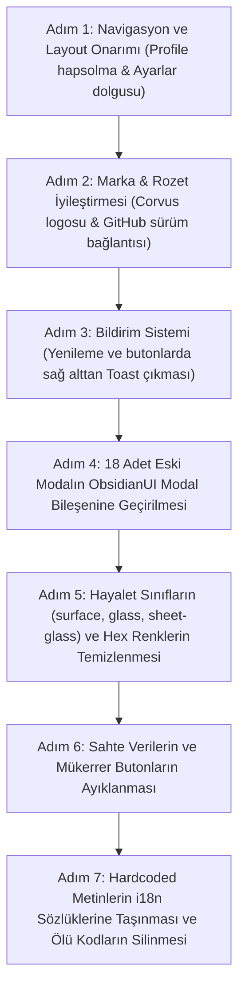

# Corvus — Kapsamlı UI/UX, Tasarım Hataları, Eski Tasarım Dili Envanteri ve Kod Denetim Raporu

**Belge Tarihi:** 14 Ekim 2026  
**Doküman Konumu:** `docs/UI_UX_AUDIT_REPORT.md`  
**Kapsam:** Frontend (React / Tailwind CSS / ObsidianUI), Layout, Modallar, Bileşenler, i18n Dil Senkronizasyonu, Sahte Veri Tespiti ve Kullanıcı Deneyimi (UX)  
**Durum:** Kapsamlı Araştırma ve Denetim Tamamlandı (Salt-Okunur İnceleme)

---

## 📌 Yönetici Özeti

Bu denetim raporu; kullanıcıdan gelen ayrıntılı geri bildirimler, sağlanan iki adet arayüz ekran görüntüsü (`NAVİGASYON` menüsü ve `Ayarlar` sayfası) ve kod tabanındaki tüm frontend sayfaları (`Dashboard`, `Containers`, `ContainerDetail`, `Services`, `Uptime`, `SystemMetrics`, `ActivityTimeline`, `Settings`, `Profile`, `PublicStatus`, `Systems`) taranarak hazırlanmıştır.

Geliştirme yapan diğer ajanın çalışma sahasına müdahale edilmeden, mevcut arayüzdeki yapısal ergonomi sorunları, eksik dolgular, görsel kaymalar, i18n ihlalleri, sahte metrikler, **eski tasarım dilinde (Midnight v1 / Glassmorphism) kalan 18 adet modal ve onlarca bileşen** ile **yetim (ölü) kodlar** eksiksiz olarak haritalandırılmıştır.

---

## 1. Profil Sayfası Navigasyon Tuzağı (Navigation Trap)

### 🔴 Sorun & Kök Neden
[src/Corvus.Web/src/components/layout/AppLayout.tsx](file:///c:/Users/sahin/Desktop/Projeler/Corvus/src/Corvus.Web/src/components/layout/AppLayout.tsx#L44-L57):
```tsx
// 'systems' and 'profile' pages render in full-width standalone layout
const isNavStandalone = currentPage === 'systems' || currentPage === 'profile';
```
`currentPage === 'profile'` olduğunda hem masaüstü sol menüsü ([Sidebar.tsx](file:///c:/Users/sahin/Desktop/Projeler/Corvus/src/Corvus.Web/src/components/Sidebar.tsx)), hem de mobil alt gezinti çubuğu ([BottomNav.tsx](file:///c:/Users/sahin/Desktop/Projeler/Corvus/src/Corvus.Web/src/components/BottomNav.tsx)) DOM'dan kaldırılmaktadır. 

Üst başlıktaki ([Header.tsx](file:///c:/Users/sahin/Desktop/Projeler/Corvus/src/Corvus.Web/src/components/layout/Header.tsx)) profil butonuna tekrar tıklandığında `onSelectPage('profile')` çağrıldığından arayüz hiçbir tepki vermemektedir. [Profile/index.tsx](file:///c:/Users/sahin/Desktop/Projeler/Corvus/src/Corvus.Web/src/pages/Profile/index.tsx) içinde ise bir geri dönüş bağlantısı (`← Dashboard'a Dön`) bulunmamaktadır. Kullanıcı sayfada hapsolmaktadır.

### 🟢 Çözüm
- `isNavStandalone` şartından `'profile'` derhal kaldırılmalı; profil sayfası standart bir yönetim görünümü olarak sol menü ve mobil menüyle birlikte çalışmalıdır.
- Profil başlığına veya üst ekmek kırıntısına (breadcrumb) `← Genel Bakış` geri butonu eklenmelidir.

---

## 2. Ayarlar Sayfasındaki Sınır / Padding Problemi ("Tam Sınırda Sığıyor")

### 🔴 Sorun & Kök Neden
Kullanıcının ilettiği `Ayarlar` ekran görüntüsünde form kartları pencerenin sağ sınırına kadar yayılmakta, içindeki yazılar, butonlar ve anahtarlar kart sınırlarına sıfır mesafede ("yapışık") durmaktadır:

1. **`.card` Sınıfında Varsayılan Padding Bulunmaması:**
   [src/Corvus.Web/src/index.css](file:///c:/Users/sahin/Desktop/Projeler/Corvus/src/Corvus.Web/src/index.css#L657):
   ```css
   .card {
     background: var(--bg-card);
     border: 1px solid var(--border-hairline);
     border-radius: var(--radius-md);
   }
   ```
   `.card` stiline yatay/dikey hiçbir `padding` verilmemiştir.
2. **`GeneralSettingsTab.tsx` İçinde Dolgu Tanımlanmaması:**
   [GeneralSettingsTab.tsx](file:///c:/Users/sahin/Desktop/Projeler/Corvus/src/Corvus.Web/src/pages/Settings/GeneralSettingsTab.tsx#L31) içinde `<div className="card space-y-6">` kullanılmış; `p-6` gibi bir iç dolgu sınıfı eklenmemiştir. Sadece elemanların altında `pb-5` bulunurken yanlarda `px-0` kalmıştır. Sonuç olarak "Dil Seçimi", "Kullanıcı Kayıtları", sağdaki `English / Türkçe` ve `Kayıtlar Kapalı` butonları kartın kenar çizgilerine temas etmektedir.
3. **Aşırı Geniş Konteyner:**
   [AppLayout.tsx](file:///c:/Users/sahin/Desktop/Projeler/Corvus/src/Corvus.Web/src/components/layout/AppLayout.tsx#L73) içinde sayfa gövdesi `max-w-[1240px]` genişliğindedir. Bir ayar ve form sayfası için 1240px fazla geniştir; form elemanları sağa-sola çok fazla dağılmakta ve ergonomik odak noktasını kaybetmektedir.

### 🟢 Çözüm
- `GeneralSettingsTab.tsx`, `BackupSettingsTab.tsx` vb. sekmelerdeki ana karta `p-6 sm:p-7` iç dolgusu eklenmelidir.
- Ayarlar sayfası genişliği `max-w-4xl` veya `max-w-5xl` seviyesine çekilerek ferah, derli toplu ve profesyonel bir form düzenine kavuşturulmalıdır.

---

## 3. Corvus Marka Kimliği & Logo Hatası

### 🔴 Sorun & Kök Neden
[Sidebar.tsx](file:///c:/Users/sahin/Desktop/Projeler/Corvus/src/Corvus.Web/src/components/Sidebar.tsx#L140-L144):
```tsx
<div className="brand-row">
  <div className="brand">
    <span className="brand-mark">C</span>
    <span>CORVUS</span>
  </div>
  <span className="mono text-[11px] text-[var(--text-muted)]">AOT</span>
</div>
```
Projede `src/Corvus.Web/public/logo_transparent.png`, `logo_full_transparent.png` ve `logo_white.svg` gibi yüksek kaliteli resmi logolar yer almasına rağmen, sol menüde bunlar kaldırılmış ve yerine ilkel bir `<span className="brand-mark">C</span>` harf kutusu konulmuştur.

### 🟢 Çözüm
Sol kenar çubuğunun tepe noktasına resmi Corvus karga/kuzgun logosu yerleştirilmelidir:
```tsx
 { (e.target as HTMLElement).style.display = 'none'; }} 
/>
```

---

## 4. Sidebar Alt Sürüm Rozeti ve GitHub Depo Bağlantısı

### 🔴 Sorun & Kök Neden
[Sidebar.tsx](file:///c:/Users/sahin/Desktop/Projeler/Corvus/src/Corvus.Web/src/components/Sidebar.tsx#L241-L248):
Şu an alt kısımda hiçbir yere tıklanmayan, GitHub logosu barındırmayan cansız bir `Corvus v1.6.2  güncel` metni bulunmaktadır.

### 🟢 Çözüm
Kullanıcının önerdiği üzere; resmi GitHub deposuna (`https://github.com/brhnshn/corvus`) doğrudan bağlantı veren, GitHub SVG ikonu içeren, üzerine gelindiğinde interaktif tepki veren şık bir sürüm bağlantısı yapılmalıdır:
```tsx
<a
  href={versionInfo?.releaseUrl || "https://github.com/brhnshn/corvus"}
  target="_blank"
  rel="noopener noreferrer"
  className="version-row hover:bg-[var(--bg-hover)] transition-all cursor-pointer rounded-[var(--radius-sm)] py-1.5 px-2 flex items-center justify-between group"
  title="GitHub Deposu ve Sürüm Notları (Changelog)"
>
  <span className="flex items-center gap-2">
    <svg className="w-3.5 h-3.5 fill-current text-[var(--text-muted)] group-hover:text-[var(--text-primary)]" viewBox="0 0 24 24">
      <path d="M12 0C5.37 0 0 5.37 0 12c0 5.31 3.435 9.795 8.205 11.385.6.105.825-.255.825-.57 0-.285-.015-1.23-.015-2.235-3.015.555-3.795-.735-4.035-1.41-.135-.345-.72-1.41-1.23-1.695-.42-.225-1.02-.78-.015-.795.945-.015 1.62.87 1.845 1.23 1.08 1.815 2.805 1.305 3.495.99.105-.78.42-1.305.765-1.605-2.67-.3-5.46-1.335-5.46-5.925 0-1.305.465-2.385 1.23-3.225-.12-.3-.54-1.53.12-3.18 0 0 1.005-.315 3.3 1.23.96-.27 1.98-.405 3-.405s2.04.135 3 .405c2.295-1.56 3.3-1.23 3.3-1.23.66 1.65.24 2.88.12 3.18.765.84 1.23 1.905 1.23 3.225 0 4.605-2.805 5.625-5.475 5.925.435.375.81 1.095.81 2.22 0 1.605-.015 2.895-.015 3.3 0 .315.225.69.825.57A12.02 12.02 0 0024 12c0-6.63-5.37-12-12-12z"/>
    </svg>
    <span className="font-mono text-xs text-[var(--cloud-200)] group-hover:text-white">Corvus v1.6.2</span>
  </span>
  <span className="mono text-[11px] text-[var(--status-up)] flex items-center gap-1 font-semibold">
    <span className="w-1.5 h-1.5 rounded-full bg-[var(--status-up)]" />
    Güncel
  </span>
</a>
```

---

## 5. Sağ Alttan Çıkan Toast Bildirimi (Demo HTML Deneyimi)

### 🔴 Sorun & Kök Neden
`Yeni Tasarımlar/corvus_obsidian_motion_ux.html` demo dosyasında (satır 1277-1280 & 2342-2370):
- "Yenile" butonuna tıklandığında `refreshWithAnimation()` çalışarak sağ alttan zaman çubuklu modern bir bildirim fırlatılmaktadır:
  `toast('Veriler ve sahne koreografisi yenilendi')`
- Ancak gerçek React uygulamasında ([App.tsx](file:///c:/Users/sahin/Desktop/Projeler/Corvus/src/Corvus.Web/src/App.tsx#L391)):
  `onRefresh={() => invalidateCache()}`
  Butona tıklandığında sadece önbellek temizlenmekte, kullanıcıya sağ alttan işlemin başarılı olduğuna dair hiçbir Toast gösterilmemektedir. Kullanıcı yenilemenin tamamlanıp tamamlanmadığını sezmekte güçlük çekmektedir.

### 🟢 Çözüm
- `App.tsx` ve `Header.tsx` üzerindeki küresel yenileme butonuna tıklandığında:
  `toast.success(t('common.refreshed') || 'Sistem telemetrisi ve veriler yenilendi')`
  tetiklenmelidir.
- [Toast.tsx](file:///c:/Users/sahin/Desktop/Projeler/Corvus/src/Corvus.Web/src/components/ui/Toast.tsx) bileşeni, demo HTML'deki Obsidian ilerleme çubuğu (`toast-progress`) animasyonuna tam uyumlu hale getirilmelidir.

---

## 6. Menü Kutu Sınırları ve Hizalama Hataları (Görsel 1 Analizi)

1. **Aşırı Parlak Beyaz Kutu:**
   `.nav-active-pill` arka planında kullanılan `#dfe3e8` beyaz rengi, koyu temada diğer menü elemanlarıyla zıtlaşarak gözü yoran sert bir blok yaratmaktadır.
   *Öneri:* Mat Obsidian stili (`rgba(255,255,255,0.08)` arka plan dolgusu + sol kenarda 2.5px ince nötr vurgu çizgisi) uygulanmalıdır.
2. **`top: 0` Eksikliği Nedeniyle Dikey Kayma:**
   `.nav-active-pill` sınıfında `top: 0` eksik olduğundan `translateY` başlangıç konumu tarayıcıya göre birkaç piksel aşağıya kaymakta, buton kutu dışına taşmış izlenimi vermektedir.
3. **Sidebar Padding Uyumsuzluğu:**
   - `.sidebar-top`: `14px` kenar boşluğu
   - `.nav-list`: `8px` kenar boşluğu
   - `.sidebar-footer`: `12px` kenar boşluğu
   Bu 6px'lik dengesizlik, menü hap kutularının sol kenara fazla yanaşmasına ve kutu sınırlarının orantısız görünmesine yol açmaktadır.
4. **Metin & İkon Eksen Uyumsuzluğu:**
   "NAVİGASYON" başlığı 8px sol dolgudayken, buton içi ikonlar 18px içeriden başlamaktadır. Başlık ve ikonlar aynı dikey hatta hizalanmalıdır.

---

## 7. Gerçek Veri Disiplini İhlalleri (Sahte / Uydurma Metrikler)

GEMINI.md kuralları gereği arayüze asla tahmini veya uydurma veri yazılamaz:

| Dosya | Satır | Uydurulan Veri | Açıklama |
|---|---|---|---|
| [Dashboard/index.tsx](file:///c:/Users/sahin/Desktop/Projeler/Corvus/src/Corvus.Web/src/pages/Dashboard/index.tsx#L181) | L181 | `memoryUsageMb={28}` | Runtime bellek telemetrisi yerine sabit **28 MB** uydurulmuş. |
| [Services/ServiceCard.tsx](file:///c:/Users/sahin/Desktop/Projeler/Corvus/src/Corvus.Web/src/pages/Services/ServiceCard.tsx#L128-L132) | L130-131 | `Array(22).fill(statusType)` & `42 / 480 ms` | Servis geçmişi yokken 22 adet sahte çubuk ve 42ms/480ms uydurma gecikme basılmış. |
| [Dashboard/index.tsx](file:///c:/Users/sahin/Desktop/Projeler/Corvus/src/Corvus.Web/src/pages/Dashboard/index.tsx#L205) | L205 | `lastCheckText="son kontrol az önce"` | Gerçek zaman damgası yerine statik string. |
| [Systems/SystemRow.tsx](file:///c:/Users/sahin/Desktop/Projeler/Corvus/src/Corvus.Web/src/pages/Systems/SystemRow.tsx#L40) | L40 | `animate-ping` | GEMINI.md kuralında açıkça yasaklanan yapay parıldama efekti. |

---

## 8. Gereksiz ve Mükerrer Butonlar (Button Bloat)

1. **DashboardHeader Aksiyon Butonları ([DashboardHeader.tsx](file:///c:/Users/sahin/Desktop/Projeler/Corvus/src/Corvus.Web/src/pages/Dashboard/DashboardHeader.tsx#L51-L93)):**
   - *Servis Ekle:* Modal açmıyor, sadece sayfaya yönlendiriyor (Sol menüdeki Servisler'in kopyası).
   - *Konteynerleri İncele:* Sol menüdeki Konteynerler'in kopyası.
   - *Canlı Durum:* Sol menüdeki Canlı Durum bağlantısının kopyası.
   - *Yenile:* Üst çubuktaki küresel Yenile butonunun kopyası.
2. **SystemBanner Butonları ([SystemBanner.tsx](file:///c:/Users/sahin/Desktop/Projeler/Corvus/src/Corvus.Web/src/pages/Dashboard/SystemBanner.tsx#L36-L54)):**
   - Zaten üstünde ve sol menüde olan *Sistem Metrikleri* ve *Konteynerler* butonlarını mükerrer basmaktadır.
3. **Mükerrer Sayfa Yenileme Butonları:**
   - `ContainersHeader.tsx`, `ServicesHeader.tsx`, `ActivityTimeline/index.tsx` içindeki "Yenile" butonları, üst çubuktaki global buton varken arayüzü kalabalıklaştırmaktadır.
4. **Konteyner Detay Sayfasındaki Çift Butonlar:**
   - [ContainerDetailHeader.tsx](file:///c:/Users/sahin/Desktop/Projeler/Corvus/src/Corvus.Web/src/pages/ContainerDetail/ContainerDetailHeader.tsx#L112-L138) başlığındaki *Canlı Loglar* ve *Web Terminali* butonları, hemen 15px altındaki sekme çubuğunda zaten yer almaktadır.

---

## 9. Hardcoded Metinler Envanteri

Tüm sayfalarda saptanan 60'tan fazla sabit Türkçe metin (Dashboard, Containers, Services, Uptime, Activity, Settings, Profile) eşzamanlı olarak `tr.ts` ve `en.ts` sözlüklerine taşınmalıdır:
- Profile: Alt başlık ve fallback şifre hata/başarı metinleri.
- Dashboard: Durum banner'ları, KPI alt başlıkları, Docker özet metinleri, TopResources ve RecentEvents tablo başlıkları.
- Containers: Tablo sütun başlıkları (`İsim & Hızlı Eylemler`, `Kaynak`, `İmaj & Portlar`, `Durum`, `Aksiyon`), ContainerRow durum etiketleri (`Çalışıyor`, `Duraklatıldı`, `Durdu`), QuickActions buton başlıkları.
- ActivityTimeline: Sayfa başlığı, kategori sekmeleri (`Tüm Olaylar`, `Konteyner`, `Servis`, `Alarmlar`, `Güvenlik & Giriş`, `Sistem`), arama placeholder'ı, boş durum açıklamaları.
- Uptime: Boş durum mesajları, UptimeBar zaman etiketleri (`Veri toplanıyor...`, `Şimdi`, `Son 45 Kontrol`, `Kronolojik Telemetri`).
- Services: `Aç` butonu, kategori ve servis silme toast bildirimleri.
- SystemMetrics: Disk durumu açıklamaları (`Birincil Sabit Disk`, `% Dolu`), KPI kısaltmaları (`Ort:`, `Min:`, `Max:`, `Boş:`).

---

## 10. Eski Tasarım Dilinde (Midnight v1 / Glassmorphism) Kalan Tüm Modallar ve Bileşenler Envanteri

Kod tabanında yapılan taramada; projenin eski sürümlerinden kalma, ObsidianUI standartlarına geçirilmemiş **18 adet modal**, **3 adet çekmece (sheet)** ve **onlarca bileşen** tespit edilmiştir.

### 🔴 A) Tek Tip Olmayan ve Eski Tasarımda Kalan 18 Modal

Şu an projenin resmi ObsidianUI modal bileşeni olan [src/Corvus.Web/src/components/ui/Modal.tsx](file:///c:/Users/sahin/Desktop/Projeler/Corvus/src/Corvus.Web/src/components/ui/Modal.tsx) kod tabanında sadece 2 yerde (`SystemdUnitsTab.tsx` ve `UsersTab.tsx`) kullanılmaktadır! Diğer 18 modal ise kendi içinde ad-hoc overlay (`fixed inset-0 bg-black/60 ...`), eski renk kodları (`bg-[#1b1d2a]` / `bg-[#161824]`) ve eski balon yarıçaplar (`rounded-2xl`, `rounded-[28px]`) kullanmaktadır:

| Modal Dosyası | Konum | Eski Tasarım Kalıntıları |
|---|---|---|
| **1. AddUserModal.tsx** | `src/Corvus.Web/src/pages/Profile/` | `bg-[#1b1d2a]`, `rounded-2xl`, `border-white/10`, ad-hoc overlay |
| **2. AddAlertRuleModal.tsx** | `src/Corvus.Web/src/pages/Settings/alerts/` | `bg-[#1b1d2a]`, `rounded-2xl`, `bg-[#0d0e15]`, ad-hoc overlay |
| **3. AddServiceModal.tsx** | `src/Corvus.Web/src/pages/Services/` | Eski overlay yapısı, ad-hoc modal |
| **4. EditServiceModal.tsx** | `src/Corvus.Web/src/pages/Services/` | Eski overlay yapısı, ad-hoc modal |
| **5. AddSnitchModal.tsx** | `src/Corvus.Web/src/pages/Uptime/` | `bg-[#161824]`, `rounded-2xl`, `border-white/10`, ad-hoc overlay |
| **6. AddIncidentModal.tsx** | `src/Corvus.Web/src/pages/Uptime/components/` | `bg-[#161824]`, `rounded-2xl`, `border-white/10`, ad-hoc overlay |
| **7. EnableUptimeModal.tsx** | `src/Corvus.Web/src/pages/Uptime/components/` | `bg-[#161824]`, `rounded-2xl`, `border-white/10`, ad-hoc overlay |
| **8. DisableUptimeDialog.tsx** | `src/Corvus.Web/src/pages/Uptime/components/` | `bg-[#161824]`, `rounded-2xl`, `border-white/10`, ad-hoc overlay |
| **9. ContainerLogsModal.tsx** | `src/Corvus.Web/src/pages/Containers/` | `bg-[#161824]`, `rounded-2xl`, `border-white/10`, ad-hoc overlay |
| **10. ContainerTerminalModal.tsx** | `src/Corvus.Web/src/pages/Containers/` | `bg-[#161824]`, `rounded-2xl`, `border-white/10`, ad-hoc overlay |
| **11. ContainerTagsModal.tsx** | `src/Corvus.Web/src/pages/Containers/` | `bg-[#161824]`, `rounded-2xl`, `border-white/10`, ad-hoc overlay |
| **12. SystemPruneModal.tsx** | `src/Corvus.Web/src/pages/Containers/` | `bg-[#161824]`, `rounded-[28px]`, `border-white/10`, ad-hoc overlay |
| **13. ImageUpdateModal.tsx** | `src/Corvus.Web/src/pages/Containers/` | `bg-[#161824]`, `rounded-2xl`, `border-white/10`, ad-hoc overlay |
| **14. ComposeConfigModal.tsx** | `src/Corvus.Web/src/pages/Containers/` | `bg-[#161824]`, `rounded-2xl`, `border-white/10`, ad-hoc overlay |
| **15. EditSystemModal.tsx** | `src/Corvus.Web/src/pages/Systems/` | `bg-[#161824]`, `rounded-2xl`, `border-white/10`, ad-hoc overlay |
| **16. DeleteSystemModal.tsx** | `src/Corvus.Web/src/pages/Systems/` | `bg-[#161824]`, `rounded-2xl`, `border-white/10`, ad-hoc overlay |
| **17. RegistrationPromptModal.tsx** | `src/Corvus.Web/src/components/` | `bg-[#161824]`, `rounded-2xl`, `border-white/10`, ad-hoc overlay |
| **18. ChunkErrorBoundary (App.tsx)** | `src/Corvus.Web/src/App.tsx#L85-L107` | `sheet-glass`, `rounded-[28px]`, `bg-[#161824]`, `rounded-2xl` |

### 🔴 B) Eski Tasarım Çekmeceleri (Sheets)
1. `src/Corvus.Web/src/pages/Containers/ContainerActionSheet.tsx` (`bg-[#161824]`, `rounded-t-[28px]`)
2. `src/Corvus.Web/src/pages/Systems/AddSystemSheet.tsx` (`bg-[#161824]`)
3. `src/Corvus.Web/src/pages/Services/DeleteConfirmSheet.tsx` (`bg-[#161824]`)

### 🔴 C) Hayalet / Tanımsız CSS Sınıfları (Phantom Classes)
Kod tabanında CSS dosyalarında (`index.css` veya `App.css`) **hiçbir tanımı bulunmayan** ancak JSX içinde çağrılan ölü sınıflar:
- `.surface`: `ProfileSecurityTab`, `ProfileUsersTab`, `ContainerDetailHeader`, `ContainerTelemetryHero`, `LogsTab`, `TerminalTab`, `PingUptimeTab`, `UptimeStatsCards`, `PushMonitorsTab`, `IncidentsTab`, `PublicStatus/*` dosyalarında onlarca kez geçmektedir.
- `.glass`: `Profile/index.tsx#L39` (`glass rounded-[19px] p-[3px]`), `PublicStatus/*`
- `.sheet-glass`: `App.tsx#L85` (`w-full max-w-md sheet-glass border border-white/10 rounded-[28px]`)

### 🔴 D) Temizlenecek Sabit Hex Renkleri (Obsidian Jeton Karşılıkları)
- `#1b1d2a` ve `#161824` ➔ `var(--bg-card)` (#131316) veya `var(--bg-shell)` (#0e0e11)
- `#0d0e15` ve `#12131c` ➔ `var(--bg-canvas)` (#0a0a0c)
- `#eceef6` ➔ `var(--text-primary)` (#eceef0)
- `#9ba0b5` ➔ `var(--text-secondary)` (#989ea6)
- `#d5d5dc` ➔ `var(--cloud-200)` (#dfe3e8)

### 🔴 E) Temizlenecek Eski Balon Yarıçapları (Border-Radius)
Eski tasarımda kullanılan `rounded-[28px]`, `rounded-[24px]`, `rounded-[22px]`, `rounded-[20px]`, `rounded-[19px]`, `rounded-[16px]` ve `rounded-2xl` sınıfları; ObsidianUI token mimarisine aykırıdır. Bunların tamamı Obsidian standartları olan:
- Küçük rozet ve butonlar için: `rounded-[var(--radius-sm)]` (5px)
- Kartlar, tablolar ve paneller için: `rounded-[var(--radius-md)]` (8px)
- Modallar ve diyaloglar için: `rounded-[var(--radius-lg)]` (10px)  
ile tekilleştirilmelidir.

---

## 11. Yetim (Ölü) Dosyalar ve Güvenle Silinecekler Listesi

Projeden zamanla çıkarılmış ancak diskte bırakılmış, hiçbir bileşen tarafından import edilmeyen kalıntılar:
1. `src/Corvus.Web/src/pages/Systems/SystemRow.tsx` (Ölü kod - 177 satır)
2. `src/Corvus.Web/src/pages/Systems/SystemsFilterBar.tsx` (Ölü kod - 40 satır)
3. `src/Corvus.Web/src/pages/Systems/SystemsKpis.tsx` (Ölü kod - 75 satır)
4. `src/Corvus.Web/src/pages/Systems/SystemsNavbar.tsx` (Ölü kod - 125 satır)
5. `src/Corvus.Web/src/pages/Systems/SystemDetailModal.tsx` (Ölü kod - 110 satır)
6. `src/Corvus.Web/src/pages/Containers/detail/ContainerDetailModal.tsx` (`ContainersPage` içerisinde import edilse bile koşulu hiçbir zaman sağlanmayan, modal yerine tam sayfa `ContainerDetailPage` kullanıldığı için atıl kalan 350 satırlık modal).

---

## 12. Eski Tasarım Kalıntılarının Temizlenmesi & Tekilleştirme Uygulama Planı



### Detaylı Görev Dağılımı:
1. **Navigasyon:** `AppLayout.tsx`'ten `'profile'` kaldırılacak. Sayfaya geri butonu konulacak.
2. **Ayarlar:** `GeneralSettingsTab.tsx` ve diğer sekmelere `p-6 sm:p-7` eklenecek, genişlik `max-w-5xl`'e çekilecek.
3. **Logo & Footer:** Sol menüdeki `C` kutusu yerine resmi `logo_transparent.png` konulacak; alttaki sürüm yazısı GitHub SVG'li interaktif linke dönüştürülecek.
4. **Toast Entegrasyonu:** `onRefresh` tıklandığında sağ altta şık bildirim belirecek; `Toast.tsx` demo HTML'deki ilerleme çubuğu animasyonuna kavuşacak.
5. **Modal Dönüşümü:** Listelenen 18 modal tek tek `<Modal>` bileşeniyle sarmalanacak, ad-hoc overlay kodları çöpe atılacak.
6. **Stil Temizliği:** Tanımsız `.surface`, `.glass`, `.sheet-glass` sınıfları kaldırılacak; `#1b1d2a`, `#161824` gibi hardcoded renkler Obsidian değişkenlerine (`var(--bg-card)`) dönüştürülecek; balon yarıçaplar (`rounded-[28px]`) yerini `var(--radius-md)` / `var(--radius-lg)`'ye bırakacak.
7. **Sahte Veri & Buton Sadeleştirmesi:** Sabit 28 MB bellek, 22 çubuklu sahte ping grafiği ve DashboardHeader/SystemBanner'daki çift butonlar temizlenecek.
8. **i18n & Ölü Dosyalar:** 60+ hardcoded metin `tr.ts`/`en.ts`'ye taşınacak; 6 adet ölü dosya projeden silinecektir.
