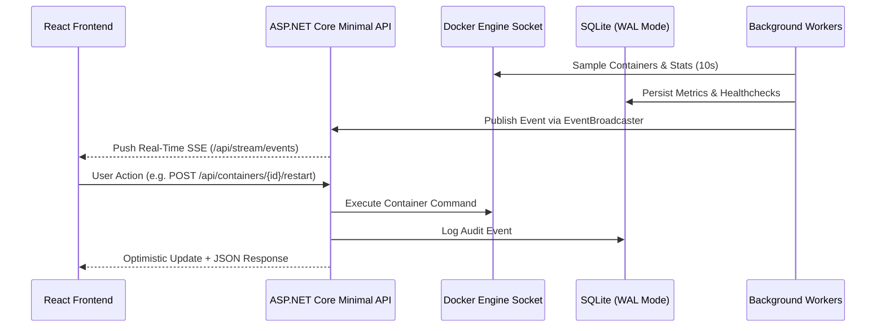
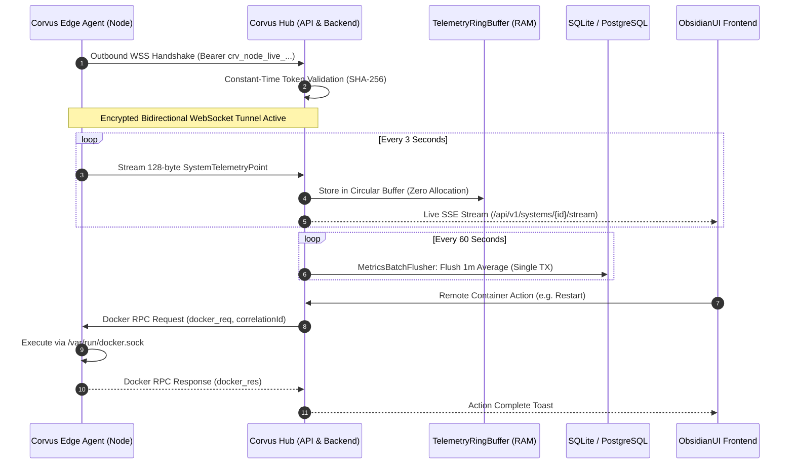

<div align="center">

[](architecture.md)
[](architecture.tr.md)

</div>

# Corvus — Repository and System Architecture

This document specifies the current file organization, layered architecture, background services, and data flow of Corvus.

---

## 📁 Directory Structure

```
corvus/
├── docker-compose.yml
├── Dockerfile                    # Multi-stage: Frontend build + .NET 9 AOT build + minimal runtime
├── Dockerfile.agent              # Minimal distroless container image for Corvus Edge Agent
├── README.md                     # Project overview and quick start (English)
├── README.tr.md                  # Project overview and quick start (Türkçe)
├── CONTRIBUTING.md               # Contribution and architecture guidelines (English)
├── CONTRIBUTING.tr.md            # Contribution and architecture guidelines (Türkçe)
├── CHANGELOG.md                  # Comprehensive release changelog (English)
├── CHANGELOG.tr.md               # Comprehensive release changelog (Türkçe)
├── LICENSE
│
├── src/
│   ├── Corvus.Agent/              # Edge Client — Standalone .NET 9 Native AOT Agent (<10 MB RAM)
│   │   ├── Program.cs             # Agent entry point, outbound WSS tunnel orchestrator & CLI args
│   │   ├── Corvus.Agent.csproj    # Native AOT, PublishTrimmed, invariant globalization
│   │   ├── Models/
│   │   │   └── AgentModels.cs     # Agent telemetry structs, Docker RPC request/response frames
│   │   └── Services/
│   │       ├── SystemMetricCollector.cs # CPU, RAM, Disk, Net I/O and LoadAvg via /proc filesystem
│   │       ├── AgentDockerClient.cs     # Docker Engine socket client, container discovery & RPC
│   │       └── AgentTunnelClient.cs     # Outbound TLS/WSS tunnel client with exponential backoff & jitter
│   │
│   ├── Corvus.Api/                # Hub & Backend — ASP.NET Core Minimal API, .NET 9 Native AOT
│   │   ├── Program.cs             # Application entry point, DI, and Minimal API mapping
│   │   ├── Corvus.Api.csproj      # Native AOT, Dapper.AOT, SQLite + PostgreSQL, System.GC.ConserveMemory=9
│   │   ├── Endpoints/             # Resource-oriented Minimal API endpoints (extension methods)
│   │   │   ├── AuthEndpoints.cs          # Session auth, registration toggle, and Zero-Trust SSO
│   │   │   ├── BackupEndpoints.cs        # One-click SQLite VACUUM INTO snapshot download
│   │   │   ├── ComposeEndpoints.cs       # Compose stack YAML/.env editor (/file) and live deploy (/deploy)
│   │   │   ├── ContainersEndpoints.cs    # Containers, /stats, /logs/stream, lifecycle, Web Terminal (/terminal), Dry-Run Prune (/system-df, /prune/selective), Inspect (/inspect), Update (/update), OCI Image Update Check (/check-update, /updates), and Recreate (/recreate)
│   │   │   ├── DashboardEndpoints.cs     # Dashboard aggregated KPI summary
│   │   │   ├── DeploymentsEndpoints.cs   # Native AOT deployment triggers (/api/containers/{id}/deploy), history (/api/deployments), cancellation, and live SSE stream (/stream)
│   │   │   ├── DeployWebhookEndpoints.cs # Constant-time token authenticated inbound deploy webhook (/api/hooks/deploy/{token}) with synchronous &wait=true CI/CD gate
│   │   │   ├── IncidentEndpoints.cs      # Incident and maintenance announcement CRUD & lifecycle
│   │   │   ├── MetricsEndpoints.cs       # Host system metrics time-series (1h-1y) and SSE stream (/stream)
│   │   │   ├── NotificationEndpoints.cs  # Multi-channel alert test endpoint (Discord, Telegram, SMTP, Slack, Ntfy, Webhooks)
│   │   │   ├── PushEndpoints.cs          # Push webhooks and Dead Man's Snitch (/push-monitors)
│   │   │   ├── ServicesEndpoints.cs      # Service CRUD, /reorder, and Systemd unit actions
│   │   │   ├── SettingsEndpoints.cs      # Dynamic system settings (RequireAdmin) and database size telemetry
│   │   │   ├── StatusPageEndpoints.cs    # Public unauthenticated status summary (/api/status-page)
│   │   │   ├── StreamEndpoints.cs        # Live Server-Sent Events stream (/api/stream/events)
│   │   │   ├── SystemsEndpoints.cs       # Multi-node Systems Cockpit (/api/v1/systems/*), node registration, RAM telemetry, SSE stream, and remote Docker RPC
│   │   │   ├── AgentTunnelEndpoints.cs   # Inbound agent WSS tunnel gateway (/api/v1/agent/tunnel)
│   │   │   ├── UptimeEndpoints.cs        # Service uptime check history, HTTP body assertion, and ICMP ping diagnostics
│   │   │   └── UsersEndpoints.cs         # RBAC user management CRUD endpoints (/api/users) with role controls
│   │   ├── BackgroundServices/    # Continuous background worker threads
│   │   │   ├── ContainerDiscoveryService.cs      # Docker socket periodic container discovery (10s), crash detection, and auto-healing trigger
│   │   │   ├── SystemMetricsCollector.cs         # Host CPU/RAM/Disk/Net metrics sampler (15s)
│   │   │   ├── UptimeCheckerService.cs           # 3-state HTTP/TCP/ICMP ping, body assertions, proactive SSL early warnings, and Snitch checks
│   │   │   ├── MemoryTrimmerBackgroundService.cs # Periodic native memory trimming, PRAGMA wal_checkpoint(TRUNCATE), Gen2 compaction & malloc_trim
│   │   │   ├── RetentionCleanupService.cs        # Dynamic retention cleanup, hourly metrics rollup (system_metrics_hourly), dual retention (7d raw / 365d hourly)
│   │   │   ├── MetricsBatchFlusherBackgroundService.cs # 60-second transactional batch flush of 1m node metrics + Graceful Shutdown zero-loss RAM flush
│   │   │   ├── MetricsRetentionWorker.cs         # Multi-node retention worker (rolls 1m metrics >7d into 1h; prunes >30d)
│   │   │   └── SystemWatchdogService.cs          # Multi-node 5-second heartbeat watchdog (online <=10s, degraded <=30s, offline >30s)
│   │   ├── Data/                  # Persistence and data access layer (Dapper.AOT + SQLite / PostgreSQL)
│   │   │   ├── DbConnectionFactory.cs        # SQLite WAL, busy_timeout=5000, PostgreSQL support & PRAGMA tuning
│   │   │   ├── DatabaseMigrator.cs           # DbUp sequential migration runner (SQLite & PostgreSQL)
│   │   │   ├── DeploymentRepository.cs       # Persistent deployment history, steps, image diffs, and log persistence
│   │   │   ├── IDeploymentRepository.cs      # Deployment repository contract
│   │   │   ├── IncidentRepository.cs         # Incident and maintenance notice data access
│   │   │   ├── ServicesRepository.cs         # Service definition and override queries
│   │   │   ├── PushMonitorRepository.cs      # Dead Man's Snitch data access
│   │   │   ├── UptimeRepository.cs           # Uptime history data access and daily rollups
│   │   │   ├── MetricsRepository.cs          # Host telemetry time-series storage, hourly rollup aggregation, and downsampled CTE queries
│   │   │   ├── BackupRepository.cs           # Push backup event logs
│   │   │   ├── UserRepository.cs             # User accounts, RBAC roles (admin, operator, viewer) and password hashing
│   │   │   ├── SessionRepository.cs          # Persistent SQLite session store (user_sessions table)
│   │   │   ├── SettingsRepository.cs         # Key-value dynamic application settings
│   │   │   ├── SystemRepository.cs           # Multi-node systems metadata, tokens, and container cache access
│   │   │   ├── SystemMetricRepository.cs     # Multi-node 1m/1h time-series metric storage and queries
│   │   │   └── Migrations/                   # Ordered migration SQL scripts
│   │   │       ├── 001_init.sql ... 013_service_tags.sql
│   │   │       ├── 014_system_logs.sql
│   │   │       ├── 015_add_service_groups.sql
│   │   │       ├── 016_systems_sqlite.sql    # Multi-node systems, tokens, metrics 1m/1h tables
│   │   │       ├── 017_users_rbac_sqlite.sql # RBAC role column (admin, operator, viewer)
│   │   │       ├── 019_deployments_sqlite.sql # Deployment audit trail & ANSI log persistence
│   │   │       └── PostgreSql/               # Native PostgreSQL equivalent migrations (001-019)
│   │   ├── Models/                 # DTOs and Database Entities
│   │   │   ├── Deployments/                  # Strongly-typed deployment domain models & Native AOT payloads
│   │   │   │   ├── DeploymentRecord.cs       # Deployment entity (trigger_type, status, steps, digests, duration)
│   │   │   │   ├── DeploymentEnums.cs        # DeploymentStatus, DeploymentTriggerSource enum definitions
│   │   │   │   └── DeploymentEvents.cs       # StepChanged, LogChunk, Completed, GlobalStarted event payloads
│   │   │   ├── Service.cs                    # Service entity (check_type: http, tcp, ping, port, ssl, expected_body, is_public, display_order)
│   │   │   ├── ServiceIncident.cs            # Incident announcement entity
│   │   │   ├── ServiceOverride.cs            # Docker label override model
│   │   │   ├── PushMonitor.cs                # Dead Man's Snitch entity
│   │   │   ├── DockerModels.cs               # Docker Engine API schemas, prune requests/results, exec resize frames, inspect models
│   │   │   ├── DockerActionResult.cs         # Container action result response
│   │   │   ├── SystemMetric.cs               # System hardware metrics sample
│   │   │   ├── SystemEntities.cs             # Multi-node SystemEntity, SystemTokenEntity, and DTOs
│   │   │   ├── SystemTelemetryPoint.cs       # 128-byte unmanaged struct for high-frequency node metrics
│   │   │   ├── SystemTelemetryStreamDto.cs   # Live SSE streaming telemetry transfer model
│   │   │   ├── SystemdModels.cs              # Systemd unit DTOs, unit action requests, and journalctl log frames
│   │   │   ├── UptimeCheck.cs                # Health check audit log
│   │   │   ├── BackupEvent.cs                # External push backup ping
│   │   │   ├── User.cs                       # User authentication & RBAC entity (admin, operator, viewer)
│   │   │   ├── VersionInfo.cs                # Update checker DTO
│   │   │   └── CorvusJsonSerializerContext.cs # .NET 9 Native AOT JsonSourceGeneration context
│   │   ├── Utils/                  # Helper utilities
│   │   │   ├── SsrfGuard.cs                  # Link-local, Cloud Metadata (169.254.169.254), and DNS Rebinding guard
│   │   │   ├── StatusCodeMatcher.cs          # HTTP status code pattern matcher (ranges and discrete codes)
│   │   │   ├── NativeMemoryTrimmer.cs        # Platform-guarded libc malloc_trim native memory reclamation
│   │   │   └── HttpBodyValidator.cs          # Zero-allocation 64 KB bounded stream content validator with ReDoS timeout
│   │   └── Services/                # Core domain business logic
│   │       ├── Deployments/                  # Container deployment execution & concurrency management
│   │       │   ├── DeploymentEngine.cs       # Dual-path streaming deployment orchestrator (pull -> recreate -> healthcheck -> live)
│   │       │   ├── IDeploymentEngine.cs      # Deployment engine interface
│   │       │   ├── DeploymentLockManager.cs  # Per-container asynchronous semaphore lock manager (fail-fast 409 Conflict)
│   │       │   └── IDeploymentLockManager.cs # Lock manager contract
│   │       ├── Docker/                       # Modularized Docker Engine client modules
│   │       │   └── DockerImageClient.cs      # Pre-pull fail-fast verification & progress stream parser
│   │       ├── DockerHttpClient.cs           # SocketsHttpHandler direct socket client (exec, prune, stats, logs)
│   │       ├── DockerService.cs              # Container operations, system prune, stats, label parsing, fail-fast pull, recreate & nano-rollback
│   │       ├── DockerLogDemuxer.cs           # Zero-alloc multiplexed Docker stdout/stderr demuxer
│   │       ├── OciRegistryClient.cs          # Zero-payload HEAD request OCI registry (Docker Hub, GHCR, Quay) digest checker
│   │       ├── ComposeFileService.cs         # Compose YAML and .env editor with TAB detection and .bak backups
│   │       ├── AutoHealingService.cs         # Thread-safe sliding-window (max 2 restarts / 15m) container auto-recovery engine
│   │       ├── IFlappingDetector.cs          # Sliding-window flapping detection interface
│   │       ├── FlappingDetector.cs           # In-memory sliding-window transition tracker & alert debounce engine
│   │       ├── NotificationService.cs        # Multi-channel alert dispatcher (Discord, Telegram, SMTP Email, Slack, Ntfy, Webhook, crash alerts)
│   │       ├── EventBroadcaster.cs           # Bounded Channel SSE real-time event publisher
│   │       ├── AuthService.cs                # Zero-Trust SSO, 100k PBKDF2 hashing, persistent SQLite session store & RBAC
│   │       ├── CorvusAuthFilter.cs           # Minimal API EndpointFilter authentication & RBAC authorization layer (viewer/operator/admin)
│   │       ├── SystemAuthService.cs          # Cryptographically secure node token generator & constant-time validator
│   │       ├── SystemTunnelManager.cs        # Active WebSocket agent tunnel pool, correlation RPC router, and binary PTY bridge
│   │       ├── SystemStatusService.cs        # Node status and storage engine reporter
│   │       ├── SystemdServiceClient.cs       # Linux systemd service & journalctl manager with regex injection defense
│   │       ├── TelemetryRingBuffer.cs        # 60-point circular telemetry buffer per node in RAM (zero allocations)
│   │       └── UpdateCheckerService.cs       # GitHub Releases version checking
│   │
│   └── Corvus.Web/                 # Frontend — TypeScript + React 19 + Vite + Tailwind CSS v4 + Vitest
│       ├── vite.config.ts          # Optimized Vite build with manual vendor chunks and Vitest configuration
│       ├── src/
│       │   ├── main.tsx
│       │   ├── App.tsx             # React.lazy route code-splitting, centralized 401 listener & SSE streaming
│       │   ├── types/              # Modular type contracts (Clean Architecture)
│       │   │   ├── index.ts        # Core API and DTO interface types
│       │   │   ├── deployments.ts  # Deployment records, step phases, and webhook types
│       │   │   └── systems.ts      # Multi-node systems, tokens, telemetry, and Systemd types
│       │   ├── api/                # Modular API client layer
│       │   │   ├── http.ts         # fetchJson (centralized corvus_unauthorized event), in-memory SWR cache, invalidateCache
│       │   │   ├── auth.ts         # Authentication & user RBAC management endpoints
│       │   │   ├── services.ts     # Service CRUD and reordering
│       │   │   ├── containers.ts   # Container operations, batch stats, logs, inspect, recreate, and deploy
│       │   │   ├── deployments.ts  # Deployment trigger, history, cancellation, and stream URL endpoints
│       │   │   ├── systems.ts      # Multi-node systems CRUD, tokens, telemetry, and remote Docker RPC
│       │   │   ├── systemd.ts      # Systemd unit listings, start/stop/restart, and journalctl log stream
│       │   │   ├── uptime.ts       # Uptime checks and push monitors
│       │   │   ├── metrics.ts      # Hardware metrics
│       │   │   ├── settings.ts     # Settings and backup
│       │   │   ├── index.ts        # Unified API object
│       │   │   └── client.ts       # Backward compatibility re-export layer
│       │   ├── hooks/              # Custom application hooks
│       │   │   ├── index.ts        # Barrel export
│       │   │   ├── useSystemMetricsStream.ts # Real-time SSE telemetry stream hook with exponential backoff
│       │   │   └── useSystemsPageState.ts   # Systems cockpit multi-node state manager
│       │   ├── i18n/               # Compile-time type-safe multi-language system
│       │   │   ├── en.ts           # Primary English dictionary (100% complete)
│       │   │   ├── tr.ts           # Turkish translation dictionary (100% complete)
│       │   │   ├── types.ts        # DeepStringify and schema types
│       │   │   └── index.tsx       # I18nProvider and useI18n hook
│       │   ├── lib/
│       │   │   └── motion.ts       # ObsidianUI motion tokens, spring physics, and runtime scale manager
│       │   ├── utils/              # Modular helper and utility functions
│       │   │   ├── ansi.ts         # Zero-allocation ANSI escape code sanitizer and HTML span parser
│       │   │   ├── url.ts          # Service URL formatter, sanitization, and port extraction (extractPort)
│       │   │   ├── lazyWithRetry.ts # Resilient lazy wrapper retrying and refreshing chunks on new deployments
│       │   │   ├── format.ts       # Byte sizing (B, KB, MB, GB, TB) formatter
│       │   │   ├── grouping.ts     # Docker Compose intelligent grouping logic
│       │   │   ├── systemsUtils.ts # System byte formatting, status theme resolver, and agent 1-liner generator
│       │   │   ├── fuzzySearch.ts  # Fuzzy match algorithm for Command Center search
│       │   │   └── tagColor.ts     # FNV-1a hash pastel palette and semantic environment presets
│       │   ├── pages/              # Domain-scoped UI view modules
│       │   │   ├── Containers/
│       │   │   │   ├── ContainerRow.tsx      # In-row 1-click Deploy and Actions trigger
│       │   │   │   ├── ContainerActionSheet.tsx # Mobile/desktop sheet with Deploy Webhook wizard
│       │   │   │   ├── deployments/          # Feature-scoped Deployment Center modules (Clean Architecture)
│       │   │   │   │   ├── DeploymentProgressModal.tsx # Live modal with F5 localStorage state recovery
│       │   │   │   │   ├── DeploymentStepper.tsx       # 5-stage progress indicator with phase timers
│       │   │   │   │   ├── DeploymentTerminalLog.tsx   # ANSI terminal viewer with copy & regex search
│       │   │   │   │   ├── DeploymentsTable.tsx        # Container deployment audit history table
│       │   │   │   │   ├── DeployWebhookWizardModal.tsx # GitHub Actions CI/CD pipeline generator
│       │   │   │   │   ├── useDeploymentStream.ts      # Resilient SSE live stream hook
│       │   │   │   │   └── useDeploymentsHistory.ts    # Deployment records query hook
│       │   │   │   └── detail/
│       │   │   │       └── ContainerDeploymentsTab.tsx # Container detail deployments tab
│       │   │   └── systems.ts      # Multi-node systems, tokens, telemetry, and Systemd types
│       │   ├── api/                # Modular API client layer
│       │   │   ├── http.ts         # fetchJson (centralized corvus_unauthorized event), in-memory SWR cache, invalidateCache
│       │   │   ├── auth.ts         # Authentication & user RBAC management endpoints
│       │   │   ├── services.ts     # Service CRUD and reordering
│       │   │   ├── containers.ts   # Container operations, batch stats, logs, inspect, recreate, and deploy
│       │   │   ├── systems.ts      # Multi-node systems CRUD, tokens, telemetry, and remote Docker RPC
│       │   │   ├── systemd.ts      # Systemd unit listings, start/stop/restart, and journalctl log stream
│       │   │   ├── uptime.ts       # Uptime checks and push monitors
│       │   │   ├── metrics.ts      # Hardware metrics
│       │   │   ├── settings.ts     # Settings and backup
│       │   │   ├── index.ts        # Unified API object
│       │   │   └── client.ts       # Backward compatibility re-export layer
│       │   ├── hooks/              # Custom application hooks
│       │   │   ├── index.ts        # Barrel export
│       │   │   ├── useSystemMetricsStream.ts # Real-time SSE telemetry stream hook with exponential backoff
│       │   │   └── useSystemsPageState.ts   # Systems cockpit multi-node state manager
│       │   ├── i18n/               # Compile-time type-safe multi-language system
│       │   │   ├── en.ts           # Primary English dictionary (100% complete)
│       │   │   ├── tr.ts           # Turkish translation dictionary (100% complete)
│       │   │   ├── types.ts        # DeepStringify and schema types
│       │   │   └── index.tsx       # I18nProvider and useI18n hook
│       │   ├── lib/
│       │   │   └── motion.ts       # ObsidianUI motion tokens, spring physics, and runtime scale manager
│       │   ├── utils/              # Modular helper and utility functions
│       │   │   ├── url.ts          # Service URL formatter, sanitization, and port extraction (extractPort)
│       │   │   ├── lazyWithRetry.ts # Resilient lazy wrapper retrying and refreshing chunks on new deployments
│       │   │   ├── format.ts       # Byte sizing (B, KB, MB, GB, TB) formatter
│       │   │   ├── grouping.ts     # Docker Compose intelligent grouping logic
│       │   │   ├── systemsUtils.ts # System byte formatting, status theme resolver, and agent 1-liner generator
│       │   │   ├── fuzzySearch.ts  # Fuzzy match algorithm for Command Center search
│       │   │   └── tagColor.ts     # FNV-1a hash pastel palette and semantic environment presets
│       │   ├── components/         # Shared global UI components & Design System
│       │   │   ├── common/                   # Shared cross-domain components
│       │   │   │   ├── ChunkErrorBoundary.tsx # Dynamic module loading & runtime error boundary shell
│       │   │   │   ├── TagFilterBar.tsx      # Reusable multi-tag filter bar with real-time counters
│       │   │   │   └── CommandPalette/       # Actionable Ctrl+K command center
│       │   │   │       ├── CommandPaletteModal.tsx
│       │   │   │       ├── CommandPaletteInput.tsx
│       │   │   │       ├── CommandPaletteResults.tsx
│       │   │   │       ├── commandItems.ts   # Command registry (> restart, > logs, > switch, > check)
│       │   │   │       └── types.ts
│       │   │   ├── ui/                       # ObsidianUI design system primitives
│       │   │   │   ├── MotionStage.tsx       # <PageStage> & <MotionItem> 42ms spring stagger wrapper
│       │   │   │   ├── AnimatedNumber.tsx    # useAnimatedNumber & <AnimatedNumber> RAF cubic-out counter
│       │   │   │   ├── AnimatedBar.tsx       # 4px spring-filled progress bar
│       │   │   │   ├── Card.tsx              # Matte obsidian surface card with 1px hairline border
│       │   │   │   ├── KpiCard.tsx & KpiRow.tsx # 4-column KPI cards with hover-lift physics
│       │   │   │   ├── QuietBanner.tsx       # Natural-language system summary banner
│       │   │   │   ├── AlertStrip.tsx        # Zero-glow matte attention & warning strip
│       │   │   │   ├── SegmentedTabs.tsx     # Gliding pill tab switcher with spring indicator
│       │   │   │   ├── Button.tsx            # Tactile scale:0.96 click physics with inline spinner morph
│       │   │   │   ├── StatusBadge.tsx & StatusDot.tsx # Matte non-glowing health badges
│       │   │   │   ├── ExpandableTable.tsx   # Accordion drawer table rows with 0fr->1fr spring animation
│       │   │   │   ├── FloatingBulkBar.tsx   # Spring-elevated bottom bulk operations toolbar
│       │   │   │   ├── UptimeStrip.tsx       # 60-bar interactive hover-wave uptime status strip
│       │   │   │   ├── Modal.tsx             # Universal physics-based modal with backdrop blur & ESC listener
│       │   │   │   ├── Toast.tsx             # Sonner-style stacked toast with 2.8s melting progress bar & Undo
│       │   │   │   └── Sheet.tsx             # Universal bottom drawer/sheet with fluid CSS physics
│       │   │   ├── layout/                   # Application layout structure
│       │   │   │   ├── AppRouter.tsx         # Route definitions with lazyWithRetry code-splitting
│       │   │   │   └── Header.tsx            # Top header with breadcrumb context, motion selector, and theme toggle
│       │   │   ├── Sidebar.tsx               # Draggable 184px-320px sidebar with gliding hover & active pills
│       │   │   ├── BottomNav.tsx             # Mobile Glass Bottom Navigation Bar
│       │   │   └── RegistrationPromptModal.tsx # Global first-admin prompt modal
│       │   ├── pages/              # Modular feature-driven page directories
│       │   │   ├── Systems/                  # Multi-Node Systems Cockpit (/systems)
│       │   │   │   ├── index.tsx             # Systems page orchestrator (<200 lines)
│       │   │   │   ├── SystemsHeader.tsx     # Title, node counter badge, add system trigger
│       │   │   │   ├── SystemsKpis.tsx       # 4-card fleet metrics strip (Total nodes, Online, CPU, RAM)
│       │   │   │   ├── SystemsFilterBar.tsx  # Search and online/offline status filter chips
│       │   │   │   ├── SystemsTable.tsx      # Multi-column fleet status table with monospace meters
│       │   │   │   ├── SystemRow.tsx         # Clickable node row with non-propagating actions
│       │   │   │   ├── SystemsColumnsMenu.tsx # Persistent column visibility toggle dropdown
│       │   │   │   ├── SystemsEmptyState.tsx # Onboarding screen with 1-liner copy script
│       │   │   │   ├── SystemsEngineBadge.tsx # Docker/Containerd engine indicator
│       │   │   │   ├── AddSystemSheet.tsx    # Node registration modal with token generator
│       │   │   │   ├── SystemDetailModal.tsx # Multi-tab node detail dialog (Overview, Containers, Systemd, Token)
│       │   │   │   └── SystemActionMenu.tsx  # React Portal dropdown with upward-flip boundary detection
│       │   │   ├── Containers/
│       │   │   │   ├── index.tsx             # Container manager orchestrator
│       │   │   │   ├── ContainerRow.tsx      # Row navigation, update badge, and action triggers
│       │   │   │   ├── ComposeConfigModal.tsx # In-browser YAML and .env editor with live Deploy trigger
│       │   │   │   ├── ImageUpdateModal.tsx  # Pull & Recreate container update modal with rollback safety
│       │   │   │   ├── ContainerLogsModal.tsx   # Live container log streaming console
│       │   │   │   └── ContainerTerminalModal.tsx # Interactive in-browser web terminal (@xterm/xterm)
│       │   │   ├── Services/
│       │   │   │   ├── index.tsx             # Service launcher and monitor orchestrator
│       │   │   │   ├── ServiceCard.tsx       # Service card with tactile physics and quick probe
│       │   │   │   ├── SystemdUnitsTab.tsx   # Linux systemd units tab orchestrator
│       │   │   │   ├── SystemdLogsModal.tsx  # Standalone journalctl log stream and copy modal
│       │   │   │   ├── SystemdConfirmModal.tsx # Unit lifecycle action confirmation modal
│       │   │   │   ├── AddServiceModal.tsx   # Service creation modal
│       │   │   │   └── EditServiceModal.tsx  # Service configuration modal
│       │   │   ├── Dashboard/
│       │   │   │   ├── index.tsx             # ObsidianUI Dashboard orchestrator
│       │   │   │   ├── SystemBanner.tsx      # Natural-language status summary banner
│       │   │   │   ├── AttentionAlerts.tsx   # Zero-glow attention alerts strip
│       │   │   │   ├── DashboardKpis.tsx     # 4-card animated KPI row
│       │   │   │   ├── TopResourcesCard.tsx  # Top memory & CPU consumer rankings
│       │   │   │   └── RecentEventsCard.tsx  # Chronological security and audit feed
│       │   │   ├── Settings/
│       │   │   │   ├── index.tsx             # Unified settings shell with tab selector
│       │   │   │   ├── GeneralSettingsTab.tsx # Retention limits and DB size telemetry
│       │   │   │   ├── UsersTab.tsx          # RBAC user accounts and role assignment tab
│       │   │   │   ├── NotificationSettingsTab.tsx # Multi-channel alert configuration
│       │   │   │   └── BackupSettingsTab.tsx # SQLite snapshot and external backup manager
│       │   │   ├── SystemMetrics/
│       │   │   │   ├── index.tsx             # Time-series telemetry shell with live SSE synchronization
│       │   │   │   ├── SystemKpiCards.tsx    # Live hardware utilization cards with <AnimatedNumber>
│       │   │   │   └── DiskStorageCard.tsx   # Disk mount and storage capacity table
│       │   │   ├── Uptime/
│       │   │   │   ├── index.tsx             # Uptime tracking orchestrator
│       │   │   │   ├── PingUptimeTab.tsx     # HTTP/TCP/ICMP ping and SSL certificate monitor
│       │   │   │   └── PushMonitorsTab.tsx   # Dead Man's Snitch heartbeat monitors
│       │   │   ├── ActivityTimeline/         # Audit event history and security timeline
│       │   │   ├── AuthPage/                 # Sign-in and initial setup view
│       │   │   └── PublicStatus/             # Unauthenticated public status dashboard (/status)
│       │   ├── __tests__/          # Vitest Unit Test Suites (29 Passing Tests)
│       │   │   ├── format.test.ts            # Byte and duration formatting test suite
│       │   │   ├── http.test.ts              # SWR HTTP cache and error handler test suite
│       │   │   ├── fuzzySearch.test.ts       # Command Center fuzzy matching test suite
│       │   │   ├── AnimatedNumber.test.tsx   # RAF counter animation component test suite
│       │   │   ├── SegmentedTabs.test.tsx    # Gliding pill tab component test suite
│       │   │   ├── ExpandableTable.test.tsx  # Accordion drawer table test suite
│       │   │   └── StatusBadge.test.tsx      # Health status badge test suite
│       │   └── test/
│       │       └── setup.ts                  # Vitest browser mock environment setup
│       └── wwwroot/                # Production compiled bundle output (hosted by Corvus.Api)
│
├── tests/
│   └── Corvus.Api.Tests/           # xUnit Test Suite (291 Passing Tests)
│       ├── AuthServiceTests.cs       # Authentication, password hashing, and session persistence
│       ├── RbacFilterTests.cs        # EndpointFilter RBAC permission enforcement (viewer/operator/admin)
│       ├── MultiNodePhase1Tests.cs   # SQLite/PostgreSql schemas, SystemRepository, RingBuffer & Structs
│       ├── MultiNodePhase2Tests.cs   # SystemAuthService, SystemTunnelManager, WebSocket RPC & Endpoints
│       ├── MultiNodePhase3Tests.cs   # Edge Agent metrics, Docker RPC, and outbound WSS tunnel client
│       ├── MetricsBatchFlusherTests.cs # 60s transactional batch flusher & Graceful Shutdown RAM flush
│       ├── SystemdServiceClientTests.cs # Systemd unit actions, regex injection defense & non-Linux guards
│       ├── ComposeFileServiceTests.cs # Compose YAML parsing, TAB validation, .bak backup & deploy
│       ├── DockerServiceTests.cs     # Container operations, system prune, micro-cache, batch stats, recreate
│       ├── DockerLogDemuxerTests.cs  # Multiplexed Docker stdout/stderr frame demuxer
│       ├── FlappingDetectorTests.cs  # Sliding-window transition tracking and flapping alert debounce
│       ├── HttpBodyValidatorTests.cs # Zero-allocation stream content verification & ReDoS timeout
│       ├── MemoryTrimmerTests.cs     # Native memory trimmer and GC optimization tests
│       ├── MetricsRepositoryTests.cs # Hourly aggregation, dual retention cleanups, and downsampling queries
│       ├── NotificationServiceTests.cs # Multi-channel dispatch (Discord, Telegram, SMTP, Slack, Ntfy)
│       ├── RoadmapFeaturesTests.cs   # Incident lifecycle, SSL expiration, and container inspect tests
│       ├── UpdateCheckerTests.cs     # GitHub Releases update checker
│       ├── StatusCodeMatcherTests.cs # HTTP status code range matcher
│       └── DatabaseMigrationAndRepositoryTests.cs # DbUp schema migrations and repository contracts
│
└── docs/                           # Technical specifications and architectural guides
    ├── branding/                   # Hex Sentinel brand identity, SVG master assets, and web icons
    ├── multi-node/                 # Multi-node architecture, protocol specifications, and UI specs
    │   ├── 01_ARCHITECTURE.md
    │   ├── 02_UI_DESIGN_SPEC.md
    │   ├── 03_WORKFLOW.md
    │   ├── 04_ACTION_PLAN.md
    │   ├── BACKEND_PROTOCOL_SPEC.md
    │   └── FRONTEND_COMPONENT_SPEC.md
    ├── architecture.md             # System architecture (English)
    ├── architecture.tr.md          # System architecture (Türkçe)
    ├── specification.md            # Technical specification (English)
    ├── specification.tr.md         # Technical specification (Türkçe)
    ├── design-system.md            # Design system and UI tokens (English)
    ├── design-system.tr.md         # Design system and UI tokens (Türkçe)
    ├── ROADMAP.md                  # Development roadmap (English)
    └── ROADMAP.tr.md               # Development roadmap (Türkçe)
```

---

## 🏛️ Clean Architecture & Modularity Principles

Corvus strictly adheres to **Clean Architecture** and **Single Responsibility** principles to maintain an elegant, maintainable, and open-source contributor-friendly codebase:

### 1. No Monolithic Files (Anti-Blob Rule)
- No single file should exceed its core responsibility. Pages are decomposed into clear feature directories (`pages/<Feature>/index.tsx`), and auxiliary tabs, modals, and list items are extracted into self-contained sub-components.

### 2. Centralized API Service Layer
- UI components **never** perform raw `fetch()` calls or handle HTTP protocol details directly.
- All backend communication is encapsulated in modular files under `src/api/` (`http.ts`, `services.ts`, `containers.ts`, etc.) with strict TypeScript typing and built-in SWR in-memory caching.

### 3. Feature-Scoped Modals and Tabs
- Modals, dialogs, and tabs that belong to a single page are colocated within that page's feature folder (e.g. `pages/Services/AddServiceModal.tsx`, `pages/Uptime/AddSnitchModal.tsx`, `pages/Containers/ContainerLogsModal.tsx`).
- `src/components/` is strictly reserved for truly global, cross-page elements (`Sidebar`, `StatusBadge`, `LanguageSwitch`, `RegistrationPromptModal`).

### 4. Utility Isolation
- Formatting, mathematical transforms, and URL normalization are never buried inside UI render trees. They reside in `src/utils/` (`url.ts`, `format.ts`, `grouping.ts`) and are covered by clean function signatures.

### 5. Backend Vertical Slices
- Endpoints are grouped cleanly by domain in `Endpoints/` as extension methods (`app.MapContainersEndpoints()`, `app.MapServicesEndpoints()`).
- Data access is segregated into dedicated Dapper repositories in `Data/`.
- Background tasks run as decoupled, resilient `BackgroundService` workers.

---

## 🔄 Data Flow & Real-Time Updates



---

## 🧠 Memory Resilience, Caching & In-Memory Optimizations

Corvus implements a multi-tier optimization architecture to sustain system memory usage within **30–45 MB** without relying on an external cache server (such as Redis):

1. **Zero-Dependency Micro-Cache:**
   - Docker socket reads (`GetContainersAsync`) and Dashboard summaries (`GET /api/dashboard/summary`) are cached for 2.5 seconds.
   - Uptime 24-hour percentage aggregations (`Get24hUptimePercentagesAsync`) are micro-cached for 5 seconds.
   - Rapid navigation between views reduces Docker socket calls and SQLite allocations by more than 90%.
2. **Batch Stats Endpoint:**
   - Replaces N+1 parallel socket reads with a single consolidated stream via `GET /api/containers/stats-summary`, gathering resource stats for all running containers at once.
3. **Smart Container Discovery Fingerprinting & Inspect Cache:**
   - `ContainerDiscoveryService` caches container environment variables by container ID and image ID (`_inspectCache`), preventing redundant Docker socket `inspect` calls on every polling cycle.
   - `ComputeFingerprint` algorithm hashes active container status and URL strings. When no state change is detected, SQLite write transactions are skipped entirely, eliminating unnecessary disk I/O and log churn.
4. **.NET 9 Elastic Memory Tuning & Hard GC Bounds:**
   - `DOTNET_GCConserveMemory=9`: Enforces aggressive decommit of idle virtual memory pages back to the Linux kernel (`madvise`) immediately after traffic bursts subside.
   - `DOTNET_GCHeapHardLimit=0x3000000`: Caps the managed GC heap at 48 MB, ensuring stable operation on constrained VPS instances.
   - `MALLOC_ARENA_MAX=2` and `MALLOC_TRIM_THRESHOLD_=65536`: Restricts glibc multi-threaded memory allocation to prevent native heap fragmentation across background threads.
5. **Scheduled Native & Managed Memory Trimming (`MemoryTrimmerBackgroundService`):**
   - Runs automatically every 3 minutes: flushes pooled SQLite connections (`SqliteConnection.ClearAllPools()`), runs an optimized Gen 1 GC pass, and calls libc `malloc_trim(0)` to return unused native allocator pages directly to the host OS.
   - `SystemMetricsCollector` reads `/proc/meminfo` via streaming `File.ReadLines()`, short-circuiting as soon as `MemTotal` and `MemAvailable` lines are parsed without loading the full file into memory.
6. **Zero-Allocation HTTP Health Checks:**
   - HTTP health checks in `UptimeCheckerService` utilize `HttpCompletionOption.ResponseHeadersRead` and explicit socket lifecycle disposal (`using var response`) to avoid buffering remote response payloads into process memory.
   - SQLite connection pool operates with `PRAGMA cache_size = -2000;` to enforce a 2MB page cache ceiling per connection.

---

## 🛡️ Advanced 3-State Health & Resilience Engine

To prevent false alarms from transient network latency or brief blips, Corvus applies a 3-state finite state machine for service health verification:
- **`healthy`:** Service responds promptly and passes HTTP 2xx/3xx or TCP port checks.
- **`degraded`:** A first failure is detected; the monitor enters degraded status with a yellow warning indicator, suppressing alarm dispatches.
- **`down`:** After 3 consecutive failures, the service transitions to down (red) and immediately dispatches alerts across configured notification webhooks (Discord, Telegram, Ntfy, Webhook).
- **Loopback Gateway Resolution:** Corvus automatically resolves loopback targets (`localhost`, `127.0.0.1`) to the Docker bridge gateway (`host.docker.internal`) so checks run accurately from within containerized environments.

---

## 🧹 Data Retention, Uptime Aggregation & Incident Lifecycle

### 1. Intelligent 24-Hour Retention (`is_transition`)
High-frequency ping checks create voluminous time-series rows over time. To maintain microsecond SQLite query execution and a minimal disk footprint without sacrificing historical fidelity:
- Routine checks where service status remains unchanged are recorded with `is_transition = 0`.
- Whenever a service changes state (`up` ➔ `down` or `down` ➔ `up`), the check record is flagged with `is_transition = 1`.
- `RetentionCleanupService` runs every 24 hours: routine checks older than 24 hours (`is_transition = 0`) are purged automatically via `idx_uptime_checks_cleanup`. State transition milestones (`is_transition = 1`) are retained up to the user-configured retention limit (`retention_days`).

### 2. 365-Day Daily Statistics Rollup (`uptime_daily_stats`)
Prior to pruning older raw checks, daily aggregates are calculated and persisted to `uptime_daily_stats`:
- Aggregates `total_checks`, `up_checks`, and `avg_response_time_ms` per service per calendar day (`date`).
- Enables instant rendering of historical uptime percentages across 30-day, 90-day, and 365-day periods without heavy table scans on `uptime_checks`.
- Historical daily statistics older than 365 days are pruned, keeping a full year of SLA memory within mere kilobytes of storage.

### 4. Time-Series Telemetry Downsampling & Hourly Rollups (`system_metrics_hourly`)
High-frequency (15-second) system metrics can quickly accumulate hundreds of thousands of rows. Corvus applies a dual-stage downsampling policy:
- **7-Day Raw Data Retention:** Full 15-second granularity records (`system_metrics`) are preserved for 7 days to facilitate high-resolution troubleshooting and short-term analysis.
- **Automated Hourly Rollup (`AggregateHourlyMetricsAsync`):** Past completed hours are automatically aggregated into `system_metrics_hourly` by `RetentionCleanupService` and `MetricsRepository`, computing average CPU, RAM, Disk, Net I/O and peak capacities with mathematical idempotency.
- **365-Day Rollup Retention:** Hourly summaries are retained for up to 365 days (or user-defined retention limit).
- **Unified Query Dispatcher:** For long-term views (`30d`, `90d`, `1y`), `GetRecentAsync` executes an optimized SQLite CTE combining historical hourly rollups with unaggregated recent hours, delivering instantaneous sub-second chart rendering with zero data gaps.

---

## 💻 In-Browser Container Web Terminal, Safe Dry-Run Prune & Container Lifecycle Architecture

### 1. Zero-Allocation Interactive WebSocket Exec Proxy (`/terminal`)
- **Direct Shell Access:** Users can launch an interactive shell (`/bin/sh`, `/bin/bash`, `/bin/ash`, `/bin/zsh`) directly into running Docker containers from the browser.
- **Bi-Directional Proxy:** The ASP.NET Core Native AOT backend establishes a hijacked HTTP 1.1 Upgrade connection to the Docker daemon (`/exec/{id}/start`) and bridges it to the client WebSocket.
- **Unfrozen Keyboard Input & Win32 Pipe Deadlock Resolution:** Resolved Windows `FlushFileBuffers` deadlocks on non-file named pipes. Unified keyboard input streaming via `@xterm/xterm` `onData` handler for seamless typing, arrow navigation, and control shortcuts (`Ctrl+C`, `Ctrl+D`, `Tab`).
- **Automatic Fallback Shell Chain:** If the requested shell is not available in minimal images (such as Alpine or Scratch-based distros), the server falls back smoothly across `/bin/bash` -> `/bin/sh` -> `/bin/ash` -> `sh`.
- **Full ANSI 256-Color Support:** Explicitly passes `TERM=xterm-256color` in exec creation environment variables for syntax highlighting and terminal apps (`htop`, `mc`, `vi`).
- **Zero GC Allocation:** Uses `ArrayPool<byte>.Shared` with static 8 KB buffers, avoiding heap pressure during high-throughput terminal sessions.
- **Immediate Resource Cleanup:** Upon client disconnect or modal closure, the Docker exec process is terminated, rented buffers returned to the pool, and system RAM restored to baseline (~30 MB).
- **Dynamic PTY Resizing:** The client transmits JSON control frames (`{type: "resize", cols, rows}`) which are automatically translated to Docker Engine `/exec/{id}/resize` API calls.
- **RBAC Security:** Exec terminal access is strictly protected under `[RequireAdmin]` (403 Forbidden for viewer accounts).

### 2. Two-Stage Dry-Run System Prune & Selective Deletion (`/system-df` & `/prune/selective`)
- **Dry-Run Audit First:** Never deletes blindly. The first stage calls Docker `GET /system/df` to inspect reclaimable space across stopped containers, unused images, dangling volumes, and build cache.
- **Granular Selection Tables:**
  - **Stopped Containers:** Individual checkbox selection with container names, images, and created timestamps (`PruneContainersTable.tsx`).
  - **Unused Images:** Individual checkbox selection with tags, IDs, and reclaimed MB/GB indicators (`PruneImagesTable.tsx`).
  - **Orphaned Volumes:** Unselected by default with high-visibility warning banner protecting persistent data against accidental deletion (`PruneVolumesTable.tsx`).
  - **Build Cache:** Selectable Docker build layer cache reclamation card (`PruneBuildCacheCard.tsx`).
- **Selective Deletion Endpoint (`POST /api/containers/prune/selective`):** Targets only the selected resource IDs while avoiding deletions of untouched assets. Reports total reclaimed disk space in real time.

### 3. Container Detail Inspection & Zero-Downtime Resource Tuning (`/inspect` & `/update`)
- **Multi-Tab Inspection Dialog (`ContainerDetailModal.tsx`):**
  - **Overview Tab:** Container ID, image tag/digest, status, health check summary, full command line (`Path + Args`), and direct action buttons (Start, Stop, Restart, Pause/Resume, Terminal, Logs).
  - **Environment Variables Tab:** Key-value table with search filtering, secret masking toggle for credentials (`PASSWORD`, `SECRET`, `KEY`, `TOKEN`), and single-key or bulk `.env` clipboard export.
  - **Networking Tab:** Published port bindings with direct one-click `http://` links, plus attached Docker networks with assigned IP addresses, Gateway, and MAC addresses.
  - **Storage Mounts Tab:** Volume and bind mounts showing host source, container destination, and Read/Write (RW/RO) permission badges.
  - **Resource Tuning Tab (`POST /api/containers/{id}/update`):** Live, zero-downtime CPU limits (`NanoCpus`), RAM limits (`Memory`), and Restart Policy modifications without restarting or rebuilding the container. In-memory micro-cache is evicted immediately upon update.

---

## 🔕 Intelligent Flapping Suppression & Alert Anti-Spam (`FlappingDetector`)

### 1. Sliding-Window Transition Tracking
Services oscillating rapidly between `up` and `down` can trigger alert fatigue and notify flood. Corvus introduces an in-memory `IFlappingDetector`:
- Tracks service state transition timestamps within a configurable sliding window (default: 5 minutes).
- **Suppression Trigger:** If transitions meet or exceed the configured threshold (default: 4 transitions), flapping state is declared. Corvus emits a single Amber warning alert (`[FLAPPING DETECTED]`) and suppresses all subsequent intermediate notifications.
- **Stability & Recovery:** Once the service achieves a consecutive number of stable checks (default: 3 checks), the suppression is lifted and a single Green recovery notification (`[FLAPPING RESOLVED]`) is dispatched.
- **Zero Leakage:** In-memory transition history is pruned automatically to prevent memory leaks over long operational runs.

### 2. Multi-Channel Alert Dispatcher (`NotificationService`)
- Outbound alerts support **Discord** (color-coded rich embeds), **Telegram** (MarkdownV2 formatting), **Email (SMTP)** (responsive dark-mode HTML template with multiple recipients), **Slack** (attachments with status color accents), **Ntfy / Gotify** (custom tags and priority levels), and **Generic Webhooks**.

---

## 🔍 HTTP Response Body Assertion Engine (`HttpBodyValidator`)

### 1. Payload Content Verification
Services returning HTTP 200 may still be displaying an application error page or database connection fault. Corvus supports deep payload verification:
- **Keyword Matching:** Asserts the presence of specific keywords (`"status":"healthy"`, `"database":"connected"`).
- **Regex Pattern Matching:** Asserts complex expressions with compiled regular expressions.

### 2. Zero-Allocation 64 KB Memory Bounding & ReDoS Defense
- Instead of buffering unbounded response bodies into heap memory, `HttpBodyValidator` streams payloads up to a strict 64 KB ceiling backed by `ArrayPool<byte>` buffers.
- Regular expression evaluations are guarded with a 200ms strict timeout to prevent Regular Expression Denial of Service (ReDoS) vulnerabilities.

---

## 🏷️ Environment Tags & Category Grouping Engine

Corvus incorporates a tag and category grouping system designed for granular workload segmentation without relational overhead:

### 1. Zero-Allocation Dual-Format Parsing & Storage
- **Schema Migration (`013_service_tags.sql`):** Adds `tags TEXT DEFAULT ''` column to both `services` and `service_overrides` tables.
- **Hybrid Parser (`ServicesRepository.ParseTags`):** Efficiently parses both serialized JSON arrays (`["Prod","DB"]`) and standard comma-separated strings (`Prod, DB`), trimming whitespace, preserving casing, and filtering duplicates in a single allocation-conscious pass.
- **Native AOT DTOs:** Integrates `List<string> Tags` within `Service`, `ServiceOverride`, `CreateServiceRequest`, and `UpdateServiceRequest` via source generation in `CorvusJsonSerializerContext`.

### 2. Automatic Docker Label Derivation & Override Protection
- **Label Mapping (`DockerService`):** Automatically extracts tags from container labels: `corvus.tags` (comma-separated), `environment`, `env`, and Compose project names (`com.docker.compose.project`).
- **Persistent Override Retention:** Custom tags applied to Docker containers are stored in `service_overrides`. Periodic rediscovery cycles merge container lifecycle state without overwriting user-assigned tags.

### 3. Modular UI Components & Deterministic Palette
- **Semantic & Hash-Based Styling (`tagColor.ts`):** Environment keywords (`prod`, `staging`, `dev`, `internal`, `db`, `api`) receive predefined semantic color tokens. Custom arbitrary tags receive deterministic pastel backgrounds and border accents via FNV-1a string hashing.
- **Interactive Multi-Tag Filter Bar (`TagFilterBar.tsx`):** Real-time service counters per tag with one-click multi-tag toggle and clear filters.
- **Dynamic Chip Input (`TagInput.tsx`):** Keyboard-driven tag creation (Enter, comma, Tab), backspace-to-remove, and instant one-click suggestions.

---

## 🌐 Multi-Node Systems Cockpit & Edge Agent Architecture

Corvus v1.6.0 introduces a distributed multi-node fleet cockpit (`/systems`), enabling administrators to observe and manage dozens of disparate VPS nodes, bare-metal servers, and remote homelabs from a single Corvus Hub without opening inbound firewall ports.

### 1. Zero Inbound Ports Topology (Outbound TLS/WSS Tunnels)
- **Edge Agent (`src/Corvus.Agent`):** A standalone, zero-reflection **.NET 9 Native AOT** binary operating with a deterministic **<10 MB RAM footprint**.
- **Outbound Reverse Connection:** The agent initiates an outbound WebSocket (`wss://`) connection to `GET /api/v1/agent/tunnel`. All telemetry streams and bidirectional Docker RPC commands travel across this encrypted tunnel.
- **Auto-Reconnection with Jitter:** When network interruptions occur, `AgentTunnelClient` reconnects using exponential backoff ($2\text{s} \to 60\text{s}$) with $\pm 500\text{ms}$ random jitter to prevent thundering herd problems against the Hub.



### 2. High-Frequency Telemetry & Zero-Allocation Memory Architecture
- **128-Byte Unmanaged Struct (`SystemTelemetryPoint`):** Metrics are packed into a fixed 128-byte unmanaged `readonly struct` comprising CPU load, memory usage, network Rx/Tx rates, disk usage, uptime, and load averages. Being unmanaged, it creates zero garbage collector heap pressure.
- **In-Memory Ring Buffer (`TelemetryRingBuffer`):** The Hub maintains a circular 60-sample buffer per connected system in RAM (representing 3 minutes of high-resolution telemetry at 3-second sampling). For 50 servers, total memory consumption is under **360 KB**.
- **Real-Time SSE Streaming:** Browsers stream telemetry directly via Server-Sent Events (`GET /api/v1/systems/{id}/stream` and `/api/v1/metrics/stream`), receiving 100ms updates without repeated HTTP request overhead.
- **Graceful Shutdown Zero-Loss Flush:** When the Hub receives a shutdown signal (`SIGTERM` / `ApplicationStopping`), `MetricsBatchFlusherBackgroundService` triggers an immediate mandatory `FlushAsync` cycle, committing all unwritten RAM telemetry to persistent storage.
- **Two-Tier Retention Engine:**
  - **Tier 1 (Raw 1m Metrics):** Stored in `system_metrics_1m` for 7 days to enable fine-grained incident post-mortems.
  - **Tier 2 (Hourly Rollups):** `MetricsRetentionWorker` aggregates 1-minute records older than 7 days into `system_metrics_1h` (average, min, max values), pruning records older than 30 days. Monthly disk footprint is limited to ~2.5 MB per monitored system.

---

## 🔒 Role-Based Access Control (RBAC) & Endpoint Authorization

Corvus v1.6.0 implements multi-tier Role-Based Access Control enforcing least privilege across the entire REST API:

| Role | Permissions & Capabilities | Mutating API Access (`POST`, `PUT`, `DELETE`) |
| :--- | :--- | :---: |
| **`admin`** | Full access: User management, node token creation/revocation, container terminal, prune, Compose deploy, Systemd management, settings. | ✅ Allowed |
| **`operator`** | Operational access: Container start/stop/restart, service health check triggers, live log inspection. No user/token management. | ✅ Allowed |
| **`viewer`** | Read-only access: View dashboard, metrics, containers, services, uptime status, and read-only logs. | ❌ Blocked (`403 Forbidden`) |

- **Security Enforcement (`CorvusAuthFilter`):** Mutating HTTP methods (`POST`, `PUT`, `PATCH`, `DELETE`) are automatically intercepted. Requests authenticated with `viewer` role accounts are terminated immediately with a `403 Forbidden` response.
- **Multi-Node Authentication (`SystemAuthService`):** Edge nodes authenticate using cryptographically generated 32-byte tokens prefixed with `crv_node_live_...`. Tokens are hashed with SHA-256 before database insertion and validated using constant-time `CryptographicOperations.FixedTimeEquals` to thwart timing attacks.

---

## 🛠️ Visual Docker Compose & Linux Systemd Service Management

### 1. In-Browser Visual Compose & .env Editor
- **Lexical TAB Detection:** YAML specification prohibits tab indentation. `PUT /api/v1/compose/{stackName}` inspects the file payload and rejects TAB characters before write, preventing broken Docker configurations.
- **Automatic `.bak` Backup:** The backend preserves the existing configuration as `{stackName}.compose.yml.bak` prior to overwriting.
- **Live Streamed Deploy:** `POST /api/v1/compose/{stackName}/deploy` runs `docker compose up -d` in the stack directory, capturing and streaming execution output line-by-line to the client.

### 2. One-Click Image Update (Pull & Recreate)
- **OCI Digest Comparison:** Inspects the container's deployed image digest against upstream registries (Docker Hub, GHCR, Quay) via lightweight `HEAD` requests.
- **Atomic Recreate with Rollback:** `POST /api/v1/containers/{id}/recreate` captures container host configuration, network attachments, and volume mounts, pulls the target image tag, stops and renames the existing container, creates the new container, and starts it. If the startup fails, the previous container is instantly restored.

### 3. Linux Systemd Unit & Journalctl Management
- **Command Injection Defense:** `SystemdServiceClient` enforces strict regex validation (`^[a-zA-Z0-9@_.-]+\.service$`) on all unit names before executing `systemctl` commands.
- **Full Unit Lifecycle:** Administrators can list system units, inspect active/failed/inactive states, and trigger `start`, `stop`, or `restart`.
- **Live `journalctl` Streaming:** Displays real-time, filtered log output from the host's systemd journal with lines and unit filtering.

---

## 🎨 ObsidianUI Design System & Motion Physics Engine

Corvus v1.6.0 introduces **ObsidianUI**, a professional, distraction-free design system engineered for high-density observability dashboards:

### 1. Visual Guardrails
- **Zero Gradients & Zero Glow:** Prohibits `linear-gradient`, `radial-gradient`, and neon `box-shadow` glows. Surfaces rely on crisp 1px hairline borders (`--border-hairline: #222328`) and matte contrast.
- **Greyish Cloud White Accent:** Uses refined neutral cloud whites (`--cloud-100: #f0f2f4` through `--cloud-500: #666b74`) rather than aggressive purple, indigo, or saturated blue accents.
- **Tabular Figures:** All metrics, IPs, ports, and percentages use `font-mono` with `tabular-nums` (`font-variant-numeric: tabular-nums`) to prevent text jitter during high-frequency telemetry updates.

### 2. Motion Design Primitives (`src/lib/motion.ts` & `src/components/ui/`)
- **Spring Deceleration Curve:** Standard animations utilize spring physics (`--ease-spring: cubic-bezier(0.22, 1, 0.36, 1)` and `--ease-out-quart: cubic-bezier(0.16, 1, 0.3, 1)`).
- **Stagger Physics (`<PageStage>` & `<MotionItem>`):** Route and tab transitions introduce child elements with a 42ms stagger delay (`calc(var(--stagger) * 42ms)`).
- **Cubic-Out Counter (`<AnimatedNumber>`):** Interpolates numerical changes smoothly over RAF ticks via $1 - (1 - p)^3$ cubic easing.
- **Gliding Pill Tabs (`<SegmentedTabs>`):** Active selection glides smoothly between pill tabs with spring physics.
- **Accordion Table Drawers (`<ExpandableTable>`):** Table detail drawers expand smoothly using CSS grid interpolation (`grid-template-rows: 0fr -> 1fr`).
- **Sonner-Style Stacked Toast (`<Toast>`):** Notifications stack in the bottom-right corner with a 2.8s melting progress bar and optional one-click **Undo** callback.
- **Motion Speed Multiplier:** Users can toggle global motion scaling in the header (Normal `1x`, Slow-Mo `0.35x`, or Instant `0x`), with full support for system `prefers-reduced-motion`.

---

## ⚡ Actionable Command Center & Keyboard Fast Actions (Ctrl+K)

The Command Palette is transformed into an actionable operational command center:

```
> restart <container>   # Restarts container with 5-second Undo toast
> logs <container>      # Instantly opens real-time streaming container log viewer
> switch <system>       # Seamlessly switches active cluster node view
> check <service>       # Executes instant HTTP/TCP health probe with latency feedback
```

- **Fuzzy Search Scoring (`fuzzySearch.ts`):** Ranks exact command matches, action prefixes (`>`), and node names above generic navigation items.
- **Undo Toast Pipeline:** Actions like container restart provide an immediate "Undo" button in the toast notification, allowing operators to reverse accidental commands.

---

## 🚀 Native AOT Deployment Center & CI/CD Inbound Webhook Architecture

Corvus v1.6.10 introduces a self-hosted **Deployment Center** (PaaS-grade container deployment engine) providing zero-downtime rolling updates, live ANSI log streaming, and synchronous CI/CD webhooks within the strict Native AOT and <30 MB RAM footprint constraint:

```
┌────────────────────────────────────────────────────────────────────────┐
│                        Inbound Deployment Trigger                      │
│        (UI Button Click  OR  POST /api/hooks/deploy/{token}?wait=true) │
└───────────────────────────────────┬────────────────────────────────────┘
                                    │
                                    ▼
                     ┌─────────────────────────────┐
                     │    DeploymentLockManager    │ ────[Duplicate]───► 409 Conflict
                     │ (Per-Container Keyed Lock)  │
                     └──────────────┬──────────────┘
                                    │ [Acquired Lock]
                                    ▼
                     ┌─────────────────────────────┐
                     │   Fail-Fast Pre-Pull Gate   │
                     │  (Remote Registry Pull)     │ ────[401/404/Timeout]─► Stop & Fail
                     └──────────────┬──────────────┘                         (Container UNTOUCHED)
                                    │ [Pull Succeeded]
                                    ▼
                     ┌─────────────────────────────┐
                     │   Atomic Nano-Rollback      │
                     │  1. Rename to _backup_ticks │
                     │  2. Spawn new container     │
                     │  3. Verify start & health   │
                     └──────┬───────────────┬──────┘
                            │               │
                  [Failed / Timeout]   [Healthy]
                            │               │
                            ▼               ▼
                 ┌────────────────────┐   ┌────────────────────┐
                 │ Nano-Rollback Path │   │ Finalize & Cleanup │
                 │ 1. Remove broken   │   │ 1. Delete backup   │
                 │ 2. Restore backup  │   │ 2. Status: Success │
                 │ 3. Status: Rolled  │   └────────────────────┘
                 └────────────────────┘
```

### 1. Keyed Concurrency Locking (`DeploymentLockManager`)
- **Race Condition Prevention:** Multiple webhook invocations or overlapping UI actions on the same container are blocked via fine-grained asynchronous semaphores (`ConcurrentDictionary<string, SemaphoreSlim>`).
- **Fail-Fast `409 Conflict`:** Any secondary deployment request arriving while a deployment is running immediately yields HTTP 409, rejecting parallel collisions without blocking thread pool resources.

### 2. Fail-Fast Pre-Pull Hard Gate (100% Uptime Guarantee)
- **Zero Premature Termination:** In traditional scripts, running containers are often stopped before the new image is pulled. If the registry fails (401 Unauthorized, 404 Not Found, network timeout), production goes down.
- **Fail-Fast Verification:** `DockerService.cs` and `DockerImageClient.cs` pull and verify the new image tag **before touching the running container**. If the pull fails, execution stops immediately, leaving the existing service 100% operational with zero downtime.

### 3. Deterministic Nano-Rollback Strategy
- **Unique Backup Names:** Existing containers are renamed to `${name}_corvus_backup_${timestamp}_${guid}` to eliminate collision vulnerabilities during rapid redeployments.
- **Ordered Atomic Recovery:** If the new container fails to create or start within its grace period:
  1. The new (broken) container is stopped and forcibly removed.
  2. The Docker engine state is checked to ensure the original container name is liberated.
  3. The backup container is renamed back to its original name and restarted.
  4. The deployment record is marked as `rolled_back` with full error logs preserved.

### 4. Dual-Path Buffering Architecture (Zero SQLite Locks)
- **The Challenge:** Docker pull streams emit 20–50 progress events per second. Writing every line to SQLite WAL would cause disk thrashing and `SQLITE_BUSY` database lock errors.
- **The Dual-Path Solution:**
  - **Path A (Real-Time Memory Stream):** Pull and container logs are pushed immediately from memory into `IEventBroadcaster` Bounded Channels, streaming live to browser SSE clients (`GET /api/deployments/{id}/stream`) with sub-millisecond latency.
  - **Path B (Throttled Batch Persistence):** The full execution log is accumulated in memory and written to the SQLite `deployments` table only during discrete phase transitions and upon final completion (3–4 total DB transactions per deployment).

### 5. Synchronous CI/CD Webhook Gate (`&wait=true`)
- **Pipeline Integration:** `POST /api/hooks/deploy/{token}?wait=true` allows GitHub Actions, GitLab CI, or custom webhooks to wait for the complete deployment:
  - If deployment succeeds and passes healthcheck: Returns **HTTP 200 OK** with execution summary.
  - If deployment fails or rolls back: Returns **HTTP 500 Internal Server Error** with detailed failure reason, immediately causing the GitHub Actions step to fail rather than silently masking deployment breakages.

### 6. Live ANSI Terminal & Resilient Session Recovery
- **ANSI Terminal Parser (`src/Corvus.Web/src/utils/ansi.ts`):** Lightweight, zero-dependency sanitizer converting ANSI SGR 256-color and style escape sequences into React CSS spans with copy-to-clipboard and regex search.
- **F5 State Recovery:** Active deployments store their identifier in `localStorage['corvus_active_deployment']`. If the user refreshes the page or navigates away, the floating progress pill and modal automatically reconnect to the live SSE stream with zero lost logs.

---

## 💡 Inspirations & Credits
Corvus is inspired by the architectural philosophies of pioneering open-source homelab, container, and observability tools, re-imagined from the ground up as a single, ultra-lightweight .NET 9 Native AOT command center:
- [Uptime Kuma](https://github.com/louislam/uptime-kuma) — Health monitoring philosophy and status page concepts
- [Beszel](https://github.com/henrygd/beszel) — Compact telemetry and system resource metrics approach
- [Portainer](https://github.com/portainer/portainer) — Container lifecycle management vision
- [Coolify](https://github.com/coollabsio/coolify) — Self-hosted deployment engine and developer experience ergonomics
- [Watchtower](https://github.com/containrrr/watchtower) — Automated container update and image polling concepts
- [Checkmate](https://github.com/bluewave-labs/checkmate) — Incident tracking and modern observability aesthetics
