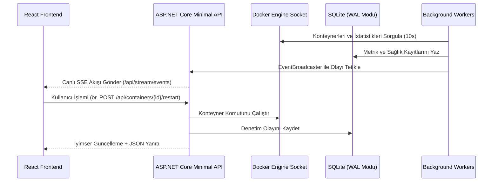
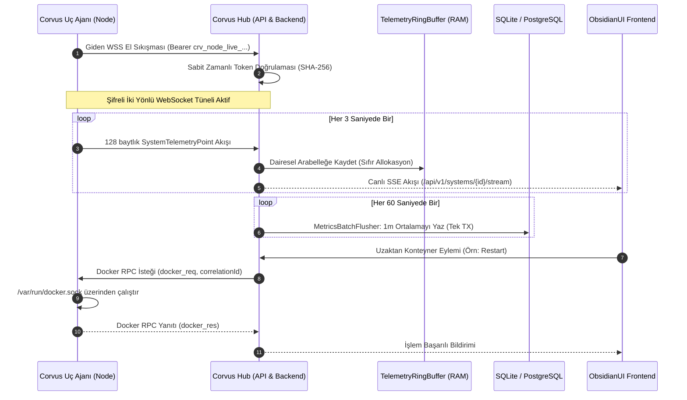

<div align="center">

[](architecture.md)
[](architecture.tr.md)

</div>

# Corvus — Klasör ve Sistem Mimarisi

Bu doküman, Corvus'un güncel dosya ve katman mimarisini, servislerini, temiz mimari standartlarını ve veri akışını belgeler.

---

## 📁 Dizin Yapısı

```
corvus/
├── docker-compose.yml
├── Dockerfile                    # Çok aşamalı: Frontend build + .NET 9 AOT build + minimal çalışma ortamı
├── Dockerfile.agent              # Corvus Uç Ajanı için minimal distroless konteyner imajı
├── README.md                     # Proje genel bakışı ve hızlı başlangıç (İngilizce)
├── README.tr.md                  # Proje genel bakışı ve hızlı başlangıç (Türkçe)
├── CONTRIBUTING.md               # Katkı sağlama ve mimari kılavuzu (İngilizce)
├── CONTRIBUTING.tr.md            # Katkı sağlama ve mimari kılavuzu (Türkçe)
├── CHANGELOG.md                  # Kapsamlı sürüm değişiklik günlüğü (İngilizce)
├── CHANGELOG.tr.md               # Kapsamlı sürüm değişiklik günlüğü (Türkçe)
├── LICENSE
│
├── src/
│   ├── Corvus.Agent/              # Uç İstemci — Bağımsız .NET 9 Native AOT Ajanı (<10 MB RAM)
│   │   ├── Program.cs             # Ajan giriş noktası, giden WSS tünel orkestratörü ve CLI argümanları
│   │   ├── Corvus.Agent.csproj    # Native AOT, PublishTrimmed, InvariantGlobalization
│   │   ├── Models/
│   │   │   └── AgentModels.cs     # Ajan telemetri modelleri, Docker RPC istek/yanıt çerçeveleri
│   │   └── Services/
│   │       ├── SystemMetricCollector.cs # /proc dosya sistemi üzerinden CPU, RAM, Disk, Ağ ve Yük Ortalaması
│   │       ├── AgentDockerClient.cs     # Docker Engine soket istemcisi, konteyner keşfi ve RPC
│   │       └── AgentTunnelClient.cs     # Üstel geri çekilme ve jitter destekli giden TLS/WSS tünel istemcisi
│   │
│   ├── Corvus.Api/                # Hub & Backend — ASP.NET Core Minimal API, .NET 9 Native AOT
│   │   ├── Program.cs             # Uygulama girişi, DI ve Minimal API orkestrasyonu
│   │   ├── Corvus.Api.csproj      # Native AOT, Dapper.AOT, SQLite + PostgreSQL, System.GC.ConserveMemory=9
│   │   ├── Endpoints/             # Kaynak odaklı Minimal API uç noktaları (extension metodlar)
│   │   │   ├── AuthEndpoints.cs          # Session auth, kayıt yönetimi ve Zero-Trust SSO
│   │   │   ├── BackupEndpoints.cs        # Tek tıkla SQLite VACUUM INTO anlık yedek indirme
│   │   │   ├── ComposeEndpoints.cs       # Compose stack YAML/.env düzenleme (/file) ve canlı dağıtım (/deploy)
│   │   │   ├── ContainersEndpoints.cs    # Containers, /stats, /logs/stream, kontroller, Web Terminali (/terminal), Kuru Çalıştırmalı Temizlik (/system-df, /prune/selective), Detay (/inspect), Güncelleme (/update), OCI İmaj Güncelleme Kontrolü (/check-update, /updates) ve Yeniden Oluşturma (/recreate)
│   │   │   ├── DashboardEndpoints.cs     # 2.5s in-memory önbellekli Dashboard KPI özeti
│   │   │   ├── DeploymentsEndpoints.cs   # Native AOT dağıtım tetikleme (/api/containers/{id}/deploy), geçmiş (/api/deployments), iptal ve canlı SSE akışı (/stream)
│   │   │   ├── DeployWebhookEndpoints.cs # CI/CD için sabit zamanlı güvenli dağıtım webhook'u (/api/hooks/deploy/{token}) ve senkron &wait=true kapısı
│   │   │   ├── IncidentEndpoints.cs      # Sistem olayları ve planlı bakım CRUD & yaşam döngüsü
│   │   │   ├── MetricsEndpoints.cs       # Sistem donanım metrikleri zaman serisi (1h-1y) ve SSE akışı (/stream)
│   │   │   ├── NotificationEndpoints.cs  # Çok kanallı alarm test uç noktası (Discord, Telegram, SMTP, Slack, Ntfy, Webhook)
│   │   │   ├── PushEndpoints.cs          # Push webhooks ve Dead Man's Snitch (/push-monitors)
│   │   │   ├── ServicesEndpoints.cs      # Servis CRUD, /reorder ve Systemd birim eylemleri
│   │   │   ├── SettingsEndpoints.cs      # Dinamik ayarlar (RequireAdmin), sürüm kontrolü (/version) ve DB disk telemetrisi
│   │   │   ├── StatusPageEndpoints.cs    # Şifresiz halka açık durum özeti (/api/status-page)
│   │   │   ├── StreamEndpoints.cs        # Canlı SSE olay akışı (/api/stream/events)
│   │   │   ├── SystemsEndpoints.cs       # Çoklu Sistem Kokpiti (/api/v1/systems/*), düğüm kaydı, RAM telemetrisi, SSE akışı ve uzaktan Docker RPC
│   │   │   ├── AgentTunnelEndpoints.cs   # Gelen ajan WSS tünel kapısı (/api/v1/agent/tunnel)
│   │   │   ├── UptimeEndpoints.cs        # Servis uptime denetim geçmişi, HTTP gövde doğrulaması ve ICMP ping testi
│   │   │   └── UsersEndpoints.cs         # RBAC kullanıcı yönetimi CRUD uç noktaları (/api/users) ve rol kontrolleri
│   │   ├── BackgroundServices/    # Arka plan çalışan iş parçacıkları
│   │   │   ├── ContainerDiscoveryService.cs      # Docker socket periyodik konteyner senkronizasyonu (10s), beklenmedik çökme tespiti ve auto-healing tetikleyicisi
│   │   │   ├── SystemMetricsCollector.cs         # Host CPU/RAM/Disk/Net metrik toplayıcısı (15s)
│   │   │   ├── UptimeCheckerService.cs           # 3 durumlu HTTP/TCP/Ping, gövde denetimi, proaktif SSL erken uyarısı ve Snitch denetimi
│   │   │   ├── MemoryTrimmerBackgroundService.cs # 3dk periyotlu SQLite havuz temizliği, PRAGMA wal_checkpoint(TRUNCATE), Gen2 agresif sıkıştırma ve malloc_trim(0)
│   │   │   ├── RetentionCleanupService.cs        # Dinamik veri saklama temizleyicisi, saatlik metrik rollup (system_metrics_hourly), ikili saklama (7g ham / 365g saatlik)
│   │   │   ├── MetricsBatchFlusherBackgroundService.cs # 60 saniyelik toplu 1m metrik yazımı + Kapanışta sıfır kayıplı zorunlu RAM flush
│   │   │   ├── MetricsRetentionWorker.cs         # Çoklu sistem retention çalışanı (7g eski 1m verilerini 1h'a sıkıştırır, >30g budar)
│   │   │   └── SystemWatchdogService.cs          # Çoklu sistem 5 saniyelik kalp atışı izleyicisi (online <=10s, degraded <=30s, offline >30s)
│   │   ├── Data/                  # Veri erişim katmanı (Dapper.AOT + SQLite / PostgreSQL)
│   │   │   ├── DbConnectionFactory.cs        # SQLite WAL, busy_timeout=5000, PostgreSQL desteği ve PRAGMA optimizasyonları
│   │   │   ├── DatabaseMigrator.cs           # DbUp sıralı göç yöneticisi (SQLite ve PostgreSQL)
│   │   │   ├── DeploymentRepository.cs       # Kalıcı dağıtım geçmişi, aşamalar, imaj özet farkları ve ANSI logları
│   │   │   ├── IDeploymentRepository.cs      # Dağıtım veri deposu arayüz sözleşmesi
│   │   │   ├── IncidentRepository.cs         # Sistem olayları ve duyurular veri erişimi
│   │   │   ├── ServicesRepository.cs         # Servis ve override sorguları
│   │   │   ├── PushMonitorRepository.cs      # Dead Man's Snitch veri erişimi
│   │   │   ├── UptimeRepository.cs           # Uptime geçmişi ve 5s önbellekli 24h yüzde agregasyonu
│   │   │   ├── MetricsRepository.cs          # Host metrikleri, saatlik özet agregasyonu ve seyreltilmiş CTE sorguları
│   │   │   ├── BackupRepository.cs           # Push backup logları
│   │   │   ├── UserRepository.cs             # Kullanıcı hesapları, RBAC rolleri (admin, operator, viewer) ve parola hashleme
│   │   │   ├── SessionRepository.cs          # Kalıcı SQLite oturum deposu (user_sessions tablosu)
│   │   │   ├── SettingsRepository.cs         # Key-value ayarlar
│   │   │   ├── SystemRepository.cs           # Çoklu sistem düğüm meta verileri, tokenler ve konteyner önbelleği
│   │   │   ├── SystemMetricRepository.cs     # Çoklu sistem 1m/1h telemetri zaman serisi veri erişimi
│   │   │   └── Migrations/                   # Sıralı göç SQL dosyaları
│   │   │       ├── 001_init.sql ... 013_service_tags.sql
│   │   │       ├── 014_system_logs.sql
│   │   │       ├── 015_add_service_groups.sql
│   │   │       ├── 016_systems_sqlite.sql    # Çoklu sistem, token ve metrik 1m/1h tabloları
│   │   │       ├── 017_users_rbac_sqlite.sql # RBAC rol sütunu (admin, operator, viewer)
│   │   │       ├── 019_deployments_sqlite.sql # Dağıtım denetim günlüğü ve ANSI log saklama şeması
│   │   │       └── PostgreSql/               # PostgreSQL eşdeğer göç scriptleri (001-019)
│   │   ├── Models/                 # DTO'lar ve Veritabanı Varlıkları
│   │   │   ├── Deployments/                  # Tip-güvenli dağıtım alanı modelleri ve Native AOT payload'ları
│   │   │   │   ├── DeploymentRecord.cs       # Dağıtım kaydı (hedef, tetikleyici, durum, aşamalar, digest, süre)
│   │   │   │   ├── DeploymentEnums.cs        # DeploymentStatus, DeploymentTriggerSource enum tanımları
│   │   │   │   └── DeploymentEvents.cs       # StepChanged, LogChunk, Completed, GlobalStarted olay modelleri
│   │   │   ├── Service.cs                    # Servis modeli (check_type: http, tcp, ping, port, ssl, expected_body, is_public, display_order)
│   │   │   ├── ServiceIncident.cs            # Sistem olay duyurusu modeli
│   │   │   ├── ServiceOverride.cs            # Docker override modeli
│   │   │   ├── PushMonitor.cs                # Dead Man's Snitch modeli
│   │   │   ├── DockerModels.cs               # Docker API modelleri, prune istek/yanıtları, exec yeniden boyutlandırma çerçeveleri
│   │   │   ├── DockerActionResult.cs         # Konteyner işlem sonucu yanıtı
│   │   │   ├── SystemMetric.cs               # Host donanım metrik modeli
│   │   │   ├── SystemEntities.cs             # Çoklu sistem SystemEntity, SystemTokenEntity ve DTO modelleri
│   │   │   ├── SystemTelemetryPoint.cs       # Yüksek frekanslı düğüm telemetrisi için 128 baytlık unmanaged struct
│   │   │   ├── SystemTelemetryStreamDto.cs   # Canlı SSE telemetri aktarım modeli
│   │   │   ├── SystemdModels.cs              # Systemd servis modelleri, eylem istekleri ve journalctl log çerçeveleri
│   │   │   ├── UptimeCheck.cs                # Uptime denetim kayıt modeli
│   │   │   ├── BackupEvent.cs                # Backup push bildirim modeli
│   │   │   ├── User.cs                       # Kullanıcı ve rol modeli (admin, operator, viewer)
│   │   │   ├── VersionInfo.cs                # Sürüm denetim DTO'su
│   │   │   └── CorvusJsonSerializerContext.cs # .NET 9 Native AOT JsonSourceGeneration bağlamı
│   │   ├── Utils/                  # Yardımcı araçlar
│   │   │   ├── SsrfGuard.cs                  # Link-local, Cloud Metadata (169.254.169.254) ve DNS Rebinding engelleyici
│   │   │   ├── StatusCodeMatcher.cs          # HTTP durum kodu aralık eşleştirici
│   │   │   ├── NativeMemoryTrimmer.cs        # Platform korumalı libc malloc_trim bellek iadesi
│   │   │   └── HttpBodyValidator.cs          # Sıfır bellek tahsisli gövde arama ve ReDoS zaman aşımı koruması
│   │   └── Services/                # Çekirdek alan iş mantığı
│   │       ├── Deployments/                  # Konteyner dağıtım yürütme ve eşzamanlılık yönetimi
│   │       │   ├── DeploymentEngine.cs       # Çift hatlı tamponlamalı dağıtım orkestratörü (pull -> recreate -> healthcheck -> live)
│   │       │   ├── IDeploymentEngine.cs      # Dağıtım motoru arayüzü
│   │       │   ├── DeploymentLockManager.cs  # Konteyner başına asenkron kilit yöneticisi (fail-fast 409 Conflict)
│   │       │   └── IDeploymentLockManager.cs # Kilit yöneticisi sözleşmesi
│   │       ├── Docker/                       # Modüler Docker motor istemci modülleri
│   │       │   └── DockerImageClient.cs      # Ön çekim (pre-pull) fail-fast doğrulama ve katman ilerleme ayrıştırıcısı
│   │       ├── DockerHttpClient.cs           # SocketsHttpHandler doğrudan soket istemcisi (exec, prune, stats, logs)
│   │       ├── DockerService.cs              # Konteyner operasyonları, sistem temizliği, stats, etiket ayrıştırma, fail-fast pull, recreate ve nano-rollback
│   │       ├── DockerLogDemuxer.cs           # Sıfır bellek tahsisli çoğullanmış Docker stdout/stderr ayrıştırıcısı
│   │       ├── OciRegistryClient.cs          # Sıfır yüklü HEAD istekleriyle OCI kayıt defteri digest denetleyicisi
│   │       ├── ComposeFileService.cs         # TAB karakter denetimli ve .bak yedekli Compose YAML/.env editör servisi
│   │       ├── AutoHealingService.cs         # Kayan pencereli konteyner otomatik kurtarma motoru
│   │       ├── IFlappingDetector.cs          # Kayan pencere dalgalanma tespit arayüzü
│   │       ├── FlappingDetector.cs           # Bellek içi dalgalanma takip ve alarm susturma motoru
│   │       ├── NotificationService.cs        # Çok kanallı alarm dağıtıcı (Discord, Telegram, SMTP, Slack, Ntfy, Webhook)
│   │       ├── EventBroadcaster.cs           # Bounded Channel SSE gerçek zamanlı olay yayıncısı
│   │       ├── AuthService*.cs               # Zero-Trust SSO, 600k PBKDF2 hashleme (Auth/PasswordHasher.cs), kalıcı oturum yönetimi ve RBAC
│   │       ├── CorvusAuthFilter.cs           # Minimal API EndpointFilter kimlik doğrulama ve RBAC yetkilendirme katmanı (viewer/operator/admin)
│   │       ├── SystemAuthService.cs          # Kriptografik güvenli düğüm token üreteci ve sabit zamanlı doğrulayıcı
│   │       ├── SystemTunnelManager.cs        # Aktif WebSocket tünelleri havuzu, correlation tabanlı RPC yönlendirici ve ikili PTY köprüsü
│   │       ├── SystemStatusService.cs        # Düğüm durumu ve depolama motoru raporlayıcısı
│   │       ├── SystemdServiceClient.cs       # Regex güvenlik zırhlı Linux systemd servis ve journalctl yöneticisi
│   │       ├── TelemetryRingBuffer.cs        # Bellekte düğüm başına 60 telemetri noktası tutan dairesel arabellek (sıfır allokasyon)
│   │       └── UpdateCheckerService.cs       # GitHub Releases sürüm denetleyicisi
│   │
│   └── Corvus.Web/                 # Frontend — TypeScript + React 19 + Vite + Tailwind CSS v4 + Vitest
│       ├── vite.config.ts          # Manuel vendor chunk'ları ve Vitest yapılandırmasıyla optimize edilmiş Vite derlemesi
│       ├── src/
│       │   ├── main.tsx
│       │   ├── App.tsx             # React.lazy rota kod bölme, merkezi 401 dinleyicisi ve SSE akışı
│       │   ├── types/              # Modüler tip sözleşmeleri (Temiz Mimari)
│       │   │   ├── index.ts        # Temel API ve DTO arayüz tipleri
│       │   │   ├── deployments.ts  # Dağıtım kayıtları, adım aşamaları ve webhook tipleri
│       │   │   └── systems.ts      # Çoklu sistem, token, telemetri ve Systemd tipleri
│       │   ├── api/                # Modüler API istemci katmanı
│       │   │   ├── http.ts         # fetchJson (merkezi oturum geçersiz kılma), SWR önbellek, invalidateCache
│       │   │   ├── auth.ts         # Kimlik doğrulama ve kullanıcı RBAC yönetim uç noktaları
│       │   │   ├── services.ts     # Servis CRUD ve sıralama
│       │   │   ├── containers.ts   # Konteyner işlemleri, batch stats, loglar, inspect, recreate ve deploy
│       │   │   ├── deployments.ts  # Dağıtım tetikleme, geçmiş, iptal ve stream URL uç noktaları
│       │   │   ├── systems.ts      # Çoklu sistem CRUD, tokenler, telemetri ve uzaktan Docker RPC
│       │   │   ├── systemd.ts      # Systemd birim listesi, start/stop/restart ve journalctl log akışı
│       │   │   ├── uptime.ts       # Uptime kontrolleri ve push monitörleri
│       │   │   ├── metrics.ts      # Donanım metrikleri
│       │   │   ├── settings.ts     # Sistem ayarları ve yedekleme
│       │   │   ├── index.ts        # Birleşik API nesnesi
│       │   │   └── client.ts       # Geriye dönük uyumluluk katmanı
│       │   ├── hooks/              # Özel uygulama kancaları
│       │   │   ├── index.ts        # Barrel dışa aktarımı
│       │   │   ├── useSystemMetricsStream.ts # Üstel geri çekilme mekanizmalı gerçek zamanlı SSE telemetri kancası
│       │   │   └── useSystemsPageState.ts   # Çoklu sistem kokpiti durum yöneticisi
│       │   ├── i18n/               # Derleme zamanı tip güvenli çoklu dil sistemi
│       │   │   ├── en.ts           # İngilizce sözlük (%100 eksiksiz)
│       │   │   ├── tr.ts           # Türkçe sözlük (%100 eksiksiz)
│       │   │   ├── types.ts        # DeepStringify ve şema tipleri
│       │   │   └── index.tsx       # I18nProvider ve useI18n hook'u
│       │   ├── lib/
│       │   │   └── motion.ts       # ObsidianUI hareket jetonları, yay fiziği ve çalışma zamanı hız yöneticisi
│       │   ├── utils/              # Modüler yardımcı fonksiyonlar
│       │   │   ├── ansi.ts         # Sıfır bağımlılıklı ANSI renk kodları ve HTML span ayrıştırıcısı
│       │   │   ├── url.ts          # Servis URL biçimlendirme, temizleme ve port ayrıştırma (extractPort)
│       │   │   ├── lazyWithRetry.ts # Yeni sürümlerde chunk yükleme hatalarını yakalayıp tazeleyen dirençli lazy sarmalayıcı
│       │   │   ├── format.ts       # Bayt boyutu (B, KB, MB, GB, TB) biçimlendirici
│       │   │   ├── grouping.ts     # Docker Compose akıllı gruplama mantığı
│       │   │   ├── systemsUtils.ts # Sistem bayt formatlama, durum tema çözücü ve ajan 1-satırlık komut üreteci
│       │   │   ├── fuzzySearch.ts  # Komut Merkezi bulanık arama algoritması
│       │   │   └── tagColor.ts     # FNV-1a hash pastel paleti ve anlamsal ortam ön ayarları
│       │   ├── pages/              # Alan odaklı UI görünüm modülleri
│       │   │   ├── Containers/
│       │   │   │   ├── ContainerRow.tsx      # Satır içi 1 tıkla Dağıt ve Eylem tetikleyicisi
│       │   │   │   ├── ContainerActionSheet.tsx # Mobil/masaüstü Dağıtım Webhook sihirbazı sayfası
│       │   │   │   ├── deployments/          # Özellik odaklı Dağıtım Merkezi modülleri (Temiz Mimari)
│       │   │   │   │   ├── DeploymentProgressModal.tsx # F5 localStorage durum kurtarmalı canlı modal
│       │   │   │   │   ├── DeploymentStepper.tsx       # Aşama sayaçlı 5 kademeli ilerleme çubuğu
│       │   │   │   │   ├── DeploymentTerminalLog.tsx   # Kopyalama ve regex aramalı ANSI terminali
│       │   │   │   │   ├── DeploymentsTable.tsx        # Konteyner dağıtım denetim geçmişi tablosu
│       │   │   │   │   ├── DeployWebhookWizardModal.tsx # GitHub Actions CI/CD boru hattı üreteci
│       │   │   │   │   ├── useDeploymentStream.ts      # Dayanıklı SSE canlı akış kancası
│       │   │   │   │   └── useDeploymentsHistory.ts    # Dağıtım kayıtları sorgulama kancası
│       │   │   │   └── detail/
│       │   │   │       └── ContainerDeploymentsTab.tsx # Konteyner detay dağıtım geçmişi sekmesi
│       │   ├── components/         # Ortak global UI bileşenleri ve Tasarım Sistemi
│       │   │   ├── common/                   # Ortak alan bileşenleri
│       │   │   │   ├── ChunkErrorBoundary.tsx # Dinamik modül ve çalışma zamanı hata yakalayıcı kabuk
│       │   │   │   ├── TagFilterBar.tsx      # Sayaçlı çoklu etiket filtreleme çubuğu
│       │   │   │   └── CommandPalette/       # Aksiyonel Ctrl+K komut merkezi
│       │   │   │       ├── CommandPaletteModal.tsx
│       │   │   │       ├── CommandPaletteInput.tsx
│       │   │   │       ├── CommandPaletteResults.tsx
│       │   │   │       ├── commandItems.ts   # Komut kayıt defteri (> restart, > logs, > switch, > check)
│       │   │   │       └── types.ts
│       │   │   ├── ui/                       # ObsidianUI tasarım sistemi bileşenleri
│       │   │   │   ├── MotionStage.tsx       # <PageStage> & <MotionItem> 42ms kademeli yay sarmalayıcısı
│       │   │   │   ├── AnimatedNumber.tsx    # useAnimatedNumber & <AnimatedNumber> RAF cubic-out sayı sayacı
│       │   │   │   ├── AnimatedBar.tsx       # 4px yay dolgulu ilerleme çubuğu
│       │   │   │   ├── Card.tsx              # 1px saç teli kenarlıklı mat obsidyen yüzey kartı
│       │   │   │   ├── KpiCard.tsx & KpiRow.tsx # Hover-lift fiziksel geçişli 4 sütunlu KPI kartları
│       │   │   │   ├── QuietBanner.tsx       # Doğal dil sistem durumu özet bandı
│       │   │   │   ├── AlertStrip.tsx        # Parlamasız mat uyarı şeridi
│       │   │   │   ├── SegmentedTabs.tsx     # Kayan yay göstergeli hap sekme değiştirici
│       │   │   │   ├── Button.tsx            # Dokunsal scale:0.96 tıklama fiziği ve durum morfolojili spinner
│       │   │   │   ├── StatusBadge.tsx & StatusDot.tsx # Parlamasız mat sağlık rozetleri
│       │   │   │   ├── ExpandableTable.tsx   # 0fr->1fr yay animasyonlu akordiyon çekmece satırları
│       │   │   │   ├── FloatingBulkBar.tsx   # Yay fiziğiyle yükselen toplu işlem çubuğu
│       │   │   │   ├── UptimeStrip.tsx       # 60 parçalı etkileşimli dalga efektli uptime çubuğu
│       │   │   │   ├── Modal.tsx             # Arka plan bulanıklıklı ve ESC dinleyicili evrensel modal
│       │   │   │   ├── Toast.tsx             # 2.8s eriyen ilerleme çubuklu ve Geri Al (Undo) destekli Sonner tarzı bildirim
│       │   │   │   └── Sheet.tsx             # Akıcı CSS fiziğine sahip alt çekmece/sheet
│       │   │   ├── layout/                   # Uygulama yerleşim yapısı
│       │   │   │   ├── AppRouter.tsx         # lazyWithRetry kod bölmeli rota tanımları
│       │   │   │   └── Header.tsx            # Sayfa bağlamı, hareket hız seçici ve tema butonlu üst bar
│       │   │   ├── Sidebar.tsx               # 184px-320px sürüklenebilir genişlikli ve kayan haplı yan menü
│       │   │   ├── BottomNav.tsx             # Mobil Cam Alt Navigasyon Barı
│       │   │   └── RegistrationPromptModal.tsx # İlk yönetici kurulumu modalı
│       │   └── pages/              # Modüler özellik bazlı sayfa klasörleri
│       │       ├── AuthPage/
│       │       │   └── index.tsx             # Giriş ve kayıt ekranı
│       │       ├── Systems/                  # Çoklu Sistem Yönetimi Kokpiti (/systems)
│       │       │   ├── index.tsx             # Sistemler sayfa orkestratörü (<200 satır)
│       │       │   ├── SystemsHeader.tsx     # Başlık, düğüm sayaç rozeti, sistem ekleme tetikleyicisi
│       │       │   ├── SystemsKpis.tsx       # 4 kartlı filo metrik şeridi (Toplam, Çevrimiçi, CPU, RAM)
│       │       │   ├── SystemsFilterBar.tsx  # Arama ve çevrimiçi/çevrimdışı durum filtreleri
│       │       │   ├── SystemsTable.tsx      # Monospace metrik sayaçlı çok sütunlu filo tablosu
│       │       │   ├── SystemRow.tsx         # Tıklanabilir düğüm satırı ve bağımsız eylem menüsü
│       │       │   ├── SystemsColumnsMenu.tsx # Kalıcı sütun görünürlüğü açma/kapama menüsü
│       │       │   ├── SystemsEmptyState.tsx # 1 satırlık kopyalama komutlu karşılama ekranı
│       │       │   ├── SystemsEngineBadge.tsx # Docker/Containerd motor rozeti
│       │       │   ├── AddSystemSheet.tsx    # Token üreteçli düğüm kayıt formu
│       │       │   ├── SystemDetailModal.tsx # Çok sekmeli düğüm detay diyaloğu (Genel, Konteynerler, Systemd, Token)
│       │       │   └── SystemActionMenu.tsx  # Yukarı açılma algılamalı React Portal açılır menüsü
│       │       ├── Containers/
│       │       │   ├── index.tsx             # Konteyner yöneticisi orkestratörü
│       │       │   ├── ContainerRow.tsx      # Satır navigasyonu, güncelleme rozeti ve eylem tetikleyicileri
│       │       │   ├── ComposeConfigModal.tsx # YAML ve .env editörlü, canlı Dağıtım tetikleyicili modal
│       │       │   ├── ImageUpdateModal.tsx  # Geri alma güvenlikli Çek & Yeniden Oluştur güncelleme modalı
│       │       │   ├── ContainerLogsModal.tsx   # Canlı konteyner log akış konsolu
│       │       │   └── ContainerTerminalModal.tsx # Etkileşimli web terminali (@xterm/xterm)
│       │       ├── Services/
│       │       │   ├── index.tsx             # Servis başlatıcı ve izleyici orkestratörü
│       │       │   ├── ServiceCard.tsx       # Dokunsal fizikli ve anlık yoklama özellikli servis kartı
│       │       │   ├── SystemdUnitsTab.tsx   # Linux systemd birimleri sekmesi
│       │       │   ├── SystemdLogsModal.tsx  # Bağımsız journalctl log akış ve kopyalama modalı
│       │       │   ├── SystemdConfirmModal.tsx # Servis durdurma/başlatma onay modalı
│       │       │   ├── AddServiceModal.tsx   # Servis oluşturma modalı
│       │       │   └── EditServiceModal.tsx  # Servis düzenleme modalı
│       │       ├── Dashboard/
│       │       │   ├── index.tsx             # ObsidianUI Dashboard orkestratörü
│       │       │   ├── SystemBanner.tsx      # Doğal dil durum özeti bandı
│       │       │   ├── AttentionAlerts.tsx   # Parlamasız dikkat ve uyarı şeridi
│       │       │   ├── DashboardKpis.tsx     # 4 kartlı animasyonlu KPI satırı
│       │       │   ├── TopResourcesCard.tsx  # En çok bellek ve CPU tüketenler sıralaması
│       │       │   └── RecentEventsCard.tsx  # Kronolojik güvenlik ve denetim geçmişi
│       │       ├── Settings/
│       │       │   ├── index.tsx             # Sekmeli birleşik ayarlar kabuğu
│       │       │   ├── GeneralSettingsTab.tsx # Veri saklama sınırları ve DB disk telemetrisi
│       │       │   ├── UsersTab.tsx          # RBAC kullanıcı hesapları ve rol atama sekmesi
│       │       │   ├── NotificationSettingsTab.tsx # Çok kanallı alarm bildirim yapılandırması
│       │       │   └── BackupSettingsTab.tsx # SQLite snapshot ve dış yedekleme yöneticisi
│       │       ├── SystemMetrics/
│       │       │   ├── index.tsx             # Canlı SSE senkronizasyonlu zaman serisi telemetri kabuğu
│       │       │   ├── SystemKpiCards.tsx    # <AnimatedNumber> ile canlı donanım kullanım kartları
│       │       │   └── DiskStorageCard.tsx   # Disk bağlama noktaları ve kapasite tablosu
│       │       ├── Uptime/
│       │       │   ├── index.tsx             # Uptime izleme orkestratörü
│       │       │   ├── PingUptimeTab.tsx     # HTTP/TCP/ICMP ping ve SSL sertifika takibi
│       │       │   └── PushMonitorsTab.tsx   # Dead Man's Snitch periyodik izleyicileri
│       │       ├── ActivityTimeline/         # Olay geçmişi ve güvenlik zaman tüneli
│       │       ├── AuthPage/                 # Giriş yapma ve ilk kurulum görünümü
│       │       └── PublicStatus/             # Şifresiz halka açık durum sayfası (/status)
│       │   ├── __tests__/          # Vitest Birim Test Paketleri (29 Başarılı Test)
│       │   │   ├── format.test.ts            # Bayt ve süre biçimlendirme testleri
│       │   │   ├── http.test.ts              # SWR HTTP önbellek ve hata yakalama testleri
│       │   │   ├── fuzzySearch.test.ts       # Komut Merkezi bulanık arama algoritması testleri
│       │   │   ├── AnimatedNumber.test.tsx   # RAF sayı animasyon bileşeni testleri
│       │   │   ├── SegmentedTabs.test.tsx    # Kayan hap sekme bileşeni testleri
│       │   │   ├── ExpandableTable.test.tsx  # Akordiyon çekmece tablo testleri
│       │   │   └── StatusBadge.test.tsx      # Sağlık durum rozeti testleri
│       │   └── test/
│       │       └── setup.ts                  # Vitest tarayıcı ortamı simülasyonu
│       └── wwwroot/                # Üretime hazır derlenmiş arayüz paketi (Corvus.Api tarafından sunulur)
│
├── tests/
│   └── Corvus.Api.Tests/           # xUnit Test Paketi (291 Başarılı Test)
│       ├── AuthServiceTests.cs       # Kimlik doğrulama, parola hashleme ve oturum kalıcılığı
│       ├── RbacFilterTests.cs        # EndpointFilter RBAC yetki denetimi (viewer/operator/admin)
│       ├── MultiNodePhase1Tests.cs   # SQLite/PostgreSql şemaları, SystemRepository, RingBuffer ve Structs
│       ├── MultiNodePhase2Tests.cs   # SystemAuthService, SystemTunnelManager, WebSocket RPC ve Uç Noktalar
│       ├── MultiNodePhase3Tests.cs   # Uç Ajan metrikleri, Docker RPC ve giden WSS tünel istemcisi
│       ├── MetricsBatchFlusherTests.cs # 60s toplu yazıcı ve Kapanışta Sıfır Kayıplı RAM Flush
│       ├── SystemdServiceClientTests.cs # Systemd birim eylemleri, regex enjeksiyon zırhı ve Linux korumaları
│       ├── ComposeFileServiceTests.cs # Compose YAML ayrıştırma, TAB denetimi, .bak yedekleme ve deploy
│       ├── DockerServiceTests.cs     # Konteyner işlemleri, sistem temizliği, micro-cache, batch stats, recreate
│       ├── DockerLogDemuxerTests.cs  # Çoğullanmış Docker stdout/stderr çerçeve ayrıştırıcısı
│       ├── FlappingDetectorTests.cs  # Kayan pencere durum takibi ve dalgalanma alarm susturma
│       ├── HttpBodyValidatorTests.cs # Sıfır bellek tahsisli gövde arama ve ReDoS zaman aşımı
│       ├── MemoryTrimmerTests.cs     # Native memory trimmer ve GC optimizasyon testleri
│       ├── MetricsRepositoryTests.cs # Saatlik agregasyon, çift aşamalı retention ve seyreltme sorgu testleri
│       ├── NotificationServiceTests.cs # Çok kanallı bildirim testleri (Discord, Telegram, SMTP, Slack, Ntfy)
│       ├── RoadmapFeaturesTests.cs   # Olay duyuruları, SSL takibi ve konteyner inspect testleri
│       ├── UpdateCheckerTests.cs     # GitHub Releases sürüm denetleyicisi
│       ├── StatusCodeMatcherTests.cs # HTTP durum kodu aralık eşleştirici
│       └── DatabaseMigrationAndRepositoryTests.cs # DbUp göçleri ve repository sözleşmeleri
│
└── docs/                           # Teknik şartnameler ve mimari kılavuzlar
    ├── branding/                   # Hex Sentinel kurumsal kimlik, SVG master vektörleri ve web ikonları
    ├── multi-node/                 # Çoklu sistem mimarisi, protokol spesifikasyonları ve UI belgeleri
    │   ├── 01_ARCHITECTURE.md
    │   ├── 02_UI_DESIGN_SPEC.md
    │   ├── 03_WORKFLOW.md
    │   ├── 04_ACTION_PLAN.md
    │   ├── BACKEND_PROTOCOL_SPEC.md
    │   └── FRONTEND_COMPONENT_SPEC.md
    ├── architecture.md             # Sistem mimarisi (İngilizce)
    ├── architecture.tr.md          # Sistem mimarisi (Türkçe)
    ├── specification.md            # Teknik şartname (İngilizce)
    ├── specification.tr.md         # Teknik şartname (Türkçe)
    ├── design-system.md            # Tasarım sistemi ve arayüz jetonları (İngilizce)
    ├── design-system.tr.md         # Tasarım sistemi ve arayüz jetonları (Türkçe)
    ├── ROADMAP.md                  # Geliştirme yol haritası (İngilizce)
    └── ROADMAP.tr.md               # Geliştirme yol haritası (Türkçe)
```

---

## 🏛️ Temiz Mimari ve Modülerlik İlkeleri

Corvus, kod tabanının açık kaynak dünyasında örnek gösterilecek seviyede şeffaf, sürdürülebilir ve katkı sağlamaya elverişli kalabilmesi için **Temiz Mimari** ve **Tek Sorumluluk** ilkelerini sıkı şekilde uygular:

### 1. Tek Dosyaya Kod Yığma Yasağı (Anti-Monolith Kuralı)
- Hiçbir dosya kendi temel sorumluluğu dışındaki kodlarla şişirilemez. Sayfalar modüler özellik klasörlerine (`pages/<Özellik>/index.tsx`) bölünür; sekmeler, formlar ve modallar bağımsız alt bileşen dosyalarına çıkarılır.

### 2. Merkezileştirilmiş API Servis Katmanı
- UI bileşenleri içinde **asla** ham `fetch()` çağrıları veya HTTP protokol detayları bulunmaz.
- Tüm backend iletişimi `src/api/client.ts` içinde tip korumalı olarak tanımlanır. Sayfalar doğrudan `api.getServices()`, `api.startContainer()` vb. çağrılar yapar.

### 3. Sayfaya Özgü Modallar ve Sekmeler
- Yalnızca tek bir sayfaya ait olan modallar, sekmeler ve diyaloglar doğrudan o sayfanın klasöründe yer alır (ör. `pages/Services/AddServiceModal.tsx`, `pages/Uptime/AddSnitchModal.tsx`, `pages/Containers/ContainerLogsModal.tsx`).
- `src/components/` dizini kesinlikle yalnızca tüm projede ortak kullanılan (`Sidebar`, `StatusBadge`, `LanguageSwitch`, `RegistrationPromptModal`) bileşenlere ayrılmıştır.

### 4. Yardımcı Fonksiyonların İzolasyonu
- URL dönüştürme, formatlama ve hesaplama mantıkları JSX render ağacının içine gömülmez. `src/utils/` (`url.ts`, `format.ts`) altında modülerleştirilerek dışa aktarılır.

### 5. Backend Dikey Dilimleri (Vertical Slices)
- Minimal API endpoint'leri `Endpoints/` altında domain bazında extension metodlar olarak gruplanır (`app.MapContainersEndpoints()`, `app.MapServicesEndpoints()`).
- Veri erişimi `Data/` altında Dapper repository'lerine bölünmüştür.
- Arka plan işleri birbirinden bağımsız `BackgroundService` sınıflarında yürütülür.

---

## 🔄 Veri Akışı ve Gerçek Zamanlı Güncellemeler



---

## 🧠 Bellek Dayanıklılığı, Caching ve In-Memory Optimizasyonları

Corvus, harici bir önbellek sunucusu (Redis vb.) çalıştırmadan sistem belleğini **30–45 MB** bandında tutmak için çok katmanlı bir optimizasyon mimarisi uygular:

1. **Sıfır Dış Bağımlılıklı Micro-Cache:**
   - Docker soket okumaları (`GetContainersAsync`) ve Dashboard özetleri (`GET /api/dashboard/summary`) 2.5 saniyelik mikro önbelleğe alınır.
   - Uptime 24 saatlik yüzde agregasyonları (`Get24hUptimePercentagesAsync`) 5 saniye önbellekte tutulur.
   - Hızlı sayfa geçişlerinde Docker soketi ve SQLite üzerinde oluşan nesne tahsisatları (allocations) %90 oranında engellenir.
2. **Toplu İstatistikler (Batch Stats Endpoint):**
   - Konteyner başına N+1 paralel `/stats` isteği yerine `GET /api/containers/stats-summary` ile çalışan tüm konteynerlerin metrikleri tek bir HTTP akışında toplanır.
3. **Akıllı Konteyner Keşfi Parmak İzi (Fingerprinting) ve Inspect Önbelleği:**
   - `ContainerDiscoveryService`, konteyner ID ve imaj ID bazlı ortam değişkenlerini önbelleğe alır (`_inspectCache`); her döngüde Docker soketine gereksiz `inspect` çağrıları yapılmasını önler.
   - `ComputeFingerprint` algoritması ile konteyner durumları ve URL'leri hash'lenir. Durum değişmediğinde SQLite veritabanına yazma işlemleri tamamen atlanır; disk I/O ve log yıpranması önlenir.
4. **.NET 9 Bellek Tasarruf Yapılandırması ve GC Sınırlandırması:**
   - `DOTNET_GCConserveMemory=9`: İstek dalgalanmaları bittiğinde boşta kalan sanal sayfaların Linux çekirdeğine (`madvise`) agresif şekilde iade edilmesini sağlar.
   - `DOTNET_GCHeapHardLimit=0x3000000`: Yönetilen GC öbeğini 48 MB ile sınırlandırarak küçük VPS'lerde bellek taşmasını engeller.
   - `MALLOC_ARENA_MAX=2` ve `MALLOC_TRIM_THRESHOLD_=65536`: Çok iş parçacıklı glibc bellek parçalanmasını (fragmentation) önler.
5. **Periyodik Native ve Yönetilen Bellek Temizleyici (`MemoryTrimmerBackgroundService`):**
   - Her 3 dakikada bir otomatik çalışır; SQLite bağlantı havuzunu boşaltır (`SqliteConnection.ClearAllPools()`), Gen 1 GC optimizasyonu tetikler ve libc `malloc_trim(0)` çağırarak kullanılmayan native belleği işletim sistemine iade eder.
   - `SystemMetricsCollector`, `/proc/meminfo` dosyasını belleğe tamamen yüklemek yerine `File.ReadLines()` ile akış halinde okur ve `MemTotal`/`MemAvailable` satırlarını bulduğu anda okumayı sonlandırır.
6. **Sıfır Gövde Tahsisatlı Sağlık Denetimi:**
   - `UptimeCheckerService` içerisindeki sağlık denetimlerinde `HttpCompletionOption.ResponseHeadersRead` ve anında `using` elden çıkarma mimarisi ile uzak servis yanıt gövdelerinin belleğe çekilmesi engellenir.
   - SQLite bağlantı havuzu `PRAGMA cache_size = -2000;` ile bağlantı başına en fazla 2MB sayfa önbelleği ile sınırlandırılır.

---

## 🛡️ Gelişmiş 3 Durumlu Dayanıklılık ve Sağlık Motoru

Servis sağlığı kontrollerinde geçici ağ dalgalanmalarının yanlış alarm (false-positive) üretmesini önlemek için 3 durumlu sonlu durum makinesi (finite state machine) kullanılır:
- **`healthy`:** Servis yanıt veriyor ve HTTP 2xx/3xx veya açık TCP portu doğrulandı.
- **`degraded`:** İlk başarısızlık tespit edildi; sistem alarm üretmez, servisi sarı uyarı moduna alır.
- **`down`:** 3 ardışık başarısızlık sonrasında servis kırmızıya döner ve yapılandırılmış bildirim kanallarına (Discord, Telegram, vb.) alarm fırlatılır.
- **Loopback Ağ Çözümlemesi:** Docker içinde çalışan Corvus'un host üzerindeki servislere (`localhost`, `127.0.0.1`) erişebilmesi için varsayılan bridge ağ geçidi (`host.docker.internal`) otomatik çözümlenir.

---

## 🧹 Veri Saklama, Uptime Agregasyonu & Olay Yaşam Döngüsü Mimarisi

### 1. Akıllı 24 Saatlik Retention Temizliği (`is_transition`)
Yüksek sıklıkta yapılan sağlık denetimleri zamanla milyonlarca satır üretir. SQLite sorgularının mikrosaniye seviyesinde kalmasını sağlamak ve disk büyümesini engellerken denetim tutarlılığını korumak için:
- Servis durumunun değişmediği rutin kontroller `is_transition = 0` bayrağıyla kaydedilir.
- Servisin durumunun değiştiği tüm anlar (`up` ➔ `down` veya `down` ➔ `up`) `is_transition = 1` olarak işaretlenir.
- `RetentionCleanupService` günde bir kez çalışır: 24 saatten eski ve durum değişimi içermeyen rutin kontroller (`is_transition = 0`) `idx_uptime_checks_cleanup` indeksi üzerinden anında temizlenir. Durum değişim anları (`is_transition = 1`) ise kullanıcının belirlediği `retention_days` süresince denetim amaçlı saklanır.

### 2. 365 Günlük Günlük İstatistik Özeti (`uptime_daily_stats`)
Eski ham kontroller silinmeden hemen önce, her servis için günlük istatistikler özetlenerek `uptime_daily_stats` tablosuna işlenir:
- Her takvim günü (`date`) için servisin `total_checks`, `up_checks` ve `avg_response_time_ms` metrikleri hesaplanır.
- 30 günlük, 90 günlük ve 365 günlük SLA ve Uptime oranları, devasa `uptime_checks` tablosu taranmadan doğrudan bu hafif özet tablosu üzerinden anlık hesaplanır.
- 365 günden eski özet kayıtları temizlenerek, tam 1 yıllık SLA geçmişi yalnızca birkaç kilobaytlık bir alanda kalıcı olarak tutulur.

### 4. Zaman Serisi Telemetri Seyreltme & Saatlik Özetler (`system_metrics_hourly`)
15 saniyelik ham sistem kaynak metrikleri zamanla yüz binlerce satıra ulaşır. Corvus, çift aşamalı bir seyreltme (downsampling) politikası uygular:
- **7 Günlük Yüksek Çözünürlüklü Ham Saklama:** Tam 15 saniyelik detaylı kayıtlar (`system_metrics`), yakın geçmişteki hata ayıklama ve anlık analizler için 7 gün boyunca saklanır.
- **Otomatik Saatlik Agregasyon (`AggregateHourlyMetricsAsync`):** Tamamlanmış geçmiş saatler `RetentionCleanupService` ve `MetricsRepository` tarafından matematiksel idempotency ile ortalama CPU, RAM, Disk, Ağ I/O ve pik kapasiteler hesaplanarak `system_metrics_hourly` tablosuna aktarılır.
- **365 Günlük Özet Saklama:** Saatlik özetler 365 gün (veya belirlenen retention süresi) boyunca korunur.
- **Birleşik Sorgu Dağıtıcısı:** Uzun vadeli aralıklar (`30d`, `90d`, `1y`) için `GetRecentAsync`, indeksli saatlik özetler ile henüz özetlenmemiş en son saatleri anında birleştiren optimize bir SQLite CTE çalıştırarak grafiklerin milisaniyeler içinde sıfır veri boşluğuyla çizilmesini sağlar.

---

## 💻 Tarayıcı İçi Konteyner Web Terminali, Güvenli Kuru Çalıştırmalı Temizlik & Konteyner Yaşam Döngüsü Mimarisi

### 1. Sıfır Bellek Tahsisatlı (Zero-Allocation) İnteraktif WebSocket Exec Proxy (`/terminal`)
- **Doğrudan Kabuk Erişimi:** Kullanıcılar tarayıcı üzerinden doğrudan çalışan Docker konteynerlerinin içine interaktif kabuk (`/bin/sh`, `/bin/bash`, `/bin/ash`, `/bin/zsh`) başlatabilir.
- **Çift Yönlü Proxy:** ASP.NET Core Native AOT arka ucu, Docker daemon ile HTTP 1.1 Upgrade bağlantısı (`/exec/{id}/start`) kurar ve bunu istemci WebSocket'ine sıfır kopya ile köprüler.
- **Klavye Giriş Kilidinin Çözülmesi & Win32 Pipe Deadlock Çözümü:** Windows ortamında dosya olmayan adlandırılmış borularda (named pipes) oluşan `FlushFileBuffers` kilitlenmeleri çözüldü. `@xterm/xterm` `onData` olayı ile çift yönlü klavye, yön tuşları ve terminal kısayolları (`Ctrl+C`, `Ctrl+D`, `Tab`) akıcı hale getirildi.
- **Otomatik Geri Çekilme Kabuk Zinciri (Fallback Shell Chain):** Minimal veya Scratch tabanlı imajlarda talep edilen kabuk bulunamadığında sunucu `/bin/bash` -> `/bin/sh` -> `/bin/ash` -> `sh` zinciriyle otomatik olarak mevcut kabuğa bağlanır.
- **Tam ANSI 256 Renk Desteği:** Renkli çıktılar, syntax vurgulamaları ve terminal uygulamaları (`htop`, `mc`, `vi`) için exec ortamına `TERM=xterm-256color` değişkeni geçirilir.
- **Sıfır GC Yükü:** `ArrayPool<byte>.Shared` üzerinden kiralanan 8 KB'lık sabit tamponlar kullanılır; yoğun terminal oturumlarında bile heap üzerinde çöp bellek tahsisatı yapılmaz.
- **Anında Kaynak İadesi:** İstemci ayrıldığında veya modal kapandığında Docker exec süreci derhal öldürülür, kiralanan bellekler iade edilir ve Corvus RAM tüketimi taban seviyesine (~30 MB) döner.
- **Dinamik PTY Boyutlandırma:** İstemci `{type: "resize", cols, rows}` kontrol mesajları gönderir; bu mesajlar doğrudan Docker `/exec/{id}/resize` API çağrılarına dönüştürülür.
- **RBAC Güvenliği:** Terminal erişimi `[RequireAdmin]` ile korunur (Gözlemci/Viewer rolleri için 403 Forbidden).

### 2. İki Aşamalı Kuru Çalıştırmalı Sistem Temizliği & Seçimli Silme (`/system-df` & `/prune/selective`)
- **Önce Analiz, Sonra Onay (Dry-Run Audit):** Asla körü körüne silme yapılmaz. İlk aşamada Docker `GET /system/df` çağrılarak durdurulmuş konteynerler, kullanılmayan imajlar, sahipsiz volumeler ve build cache kalem kalem taranır ve kazanılacak alan hesaplanır.
- **Ayrıntılı Seçim Tabloları:**
  - **Durdurulmuş Konteynerler:** Konteyner adı, imajı ve oluşturulma tarihiyle tek tek seçilebilir tablo (`PruneContainersTable.tsx`).
  - **Kullanılmayan İmajlar:** İmaj etiketi, ID'si ve kazanılacak MB/GB büyüklüğüyle bağımsız seçim (`PruneImagesTable.tsx`).
  - **Yetim Hacimler (Volumes):** Kalıcı veri kaybını önlemek amacıyla **varsayılan olarak kapalı** ve veri kaybı uyarı banner'ı ile korunan seçim tablosu (`PruneVolumesTable.tsx`).
  - **Build Cache:** Docker derleme katman önbelleğini temizleme seçeneği (`PruneBuildCacheCard.tsx`).
- **Seçimli Silme Uç Noktası (`POST /api/containers/prune/selective`):** Yalnızca kullanıcının işaretlediği varlıkları siler; seçilmeyenlere dokunmaz. Kurtarılan disk alanını anlık olarak raporlar.

### 3. Konteyner Detay İnceleme & Sıfır Kesintili Kaynak Yönetimi (`/inspect` & `/update`)
- **Çok Sekmeli Detay Modalı (`ContainerDetailModal.tsx`):**
  - **Genel Bakış Sekmesi:** Konteyner ID, imaj etiketi/özeti, çalışma durumu, sağlık denetimi sonucu, tam komut satırı (`Path + Args`) ve doğrudan eylem araç çubuğu (Başlat, Durdur, Yeniden Başlat, Duraklat/Sürdür, Terminal, Günlükler).
  - **Ortam Değişkenleri Sekmesi:** Arama filtreli anahtar-değer tablosu, hassas anahtarlar için (`PASSWORD`, `SECRET`, `KEY`, `TOKEN`) tek tıkla maskeleme/açma ve tekil/toplu `.env` panoya kopyalama.
  - **Ağ Sekmesi:** Yayınlanan port eşleştirmeleri (tıklanabilir `http://` bağlantıları) ve bağlı Docker ağları (IP, Ağ Geçidi, MAC adresi).
  - **Depolama Bağlantıları Sekmesi:** Hacim (volume) ve host dizin bağlamaları (mounts), host kaynağı, konteyner hedefi ve Okuma/Yazma (RW/RO) izinleri.
  - **Kaynak Ayarları Sekmesi (`POST /api/containers/{id}/update`):** Konteyneri durdurmadan veya yeniden oluşturmadan sıfır kesintiyle (zero-downtime) CPU çekirdek limiti (`NanoCpus`), RAM sınırı (`Memory`) ve Yeniden Başlatma İlkesi (Restart Policy) canlı güncelleme. İşlem sonrası bellek içi micro-cache otomatik temizlenir.

---

## 🔕 Akıllı Dalgalanma Engelleme & Alarm Susturma (`FlappingDetector`)

### 1. Kayan Pencere Durum Takibi
Kısa süre içinde sürekli `up` ve `down` arasında gidip gelen servisler operasyon ekiplerinde alarm yorgunluğuna ve bildirim kirliliğine yol açar. Corvus, bellek içi `IFlappingDetector` motorunu sunar:
- Servisin durum değişim zaman damgalarını yapılandırılabilir kayan bir pencerede (varsayılan: 5 dakika) izler.
- **Susturma Eşiği:** Değişim sayısı eşiğe (varsayılan: 4 değişim) ulaştığında servis dalgalanma (flapping) durumuna geçer. Corvus tek bir Sarı uyarı bildirimi (`[DALGALANMA TESPİT EDİLDİ]`) gönderir ve ara durum bildirimlerini tamamen susturur.
- **Kararlılık ve Kurtarma:** Servis belirlenen sayıda ardışık başarılı kontrol (varsayılan: 3 kontrol) sağladığında susturma kaldırılır ve tek bir Yeşil kurtarma bildirimi (`[DALGALANMA SONA ERDİ]`) iletilir.
- **Sıfır Bellek Sızıntısı:** Bellek içi geçiş geçmişi düzenli olarak budanarak uzun çalışma sürelerinde RAM şişmesi engellenir.

### 2. Çok Kanallı Alarm Dağıtıcısı (`NotificationService`)
- Dışa aktarılan alarmlar **Discord** (renkli zengin embed), **Telegram** (MarkdownV2), **E-posta (SMTP)** (responsive koyu mod HTML şablonu ve çoklu alıcı), **Slack** (renk vurgulu attachment'lar), **Ntfy / Gotify** (özel etiketler ve öncelik seviyeleri) ve **Özel Webhook** kanallarını destekler.

---

## 🔍 HTTP Yanıt Gövdesi Doğrulama Motoru (`HttpBodyValidator`)

### 1. Yük İçeriği Denetimi
HTTP 200 dönen servisler arka planda veritabanı bağlantı hatası veya uygulama arıza sayfası veriyor olabilir. Corvus derin yük doğrulaması sunar:
- **Anahtar Kelime Eşleme:** Belirli anahtar kelimelerin (`"status":"healthy"`, `"database":"connected"`) varlığını doğrular.
- **Regex Desen Eşleme:** Derlenmiş düzenli ifadelerle karmaşık durum yanıtlarını denetler.

### 2. Sıfır Bellek Tahsisli 64 KB Sınırı & ReDoS Koruması
- Yanıt gövdesini sınırsızca belleğe çekmek yerine `HttpBodyValidator`, `ArrayPool<byte>` tamponları üzerinden en fazla 64 KB'a kadar akış okuması yapar.
- Regex değerlendirmeleri, Regular Expression Denial of Service (ReDoS) açıklarını önlemek için katı bir 200ms zaman aşımı ile sınırlandırılmıştır.

---

## 🏷️ Ortam Etiketleri & Kategori Gruplama Motoru

Corvus, ilişkisel veritabanı karmaşıklığı yaratmadan servisleri ve konteynerleri serbestçe kategorize etmek ve filtrelemek için modüler bir etiketleme mimarisi sunar:

### 1. Sıfır Tahsisatlı İkili Format Ayrıştırma & Saklama
- **Veritabanı Göçü (`013_service_tags.sql`):** `services` ve `service_overrides` tablolarına `tags TEXT DEFAULT ''` kolonu kesintisiz olarak eklenmiştir.
- **Hibrit Ayrıştırıcı (`ServicesRepository.ParseTags`):** Hem JSON serileştirilmiş dizileri (`["Prod","DB"]`) hem de virgülle ayrılmış standart metinleri (`Prod, DB`) tek bir tahsisat-dostu döngüde ayrıştırır, boşlukları temizler, harf büyüklüğünü korur ve mükerrerleri eler.
- **Native AOT DTO Desteği:** `Service`, `ServiceOverride`, `CreateServiceRequest` ve `UpdateServiceRequest` modellerine `List<string> Tags` eklenmiş ve `CorvusJsonSerializerContext` içinde derleme zamanında tip güvenliği sağlanmıştır.

### 2. Otomatik Docker Etiket Çıkarımı & Override Koruması
- **Etiket Eşleme (`DockerService`):** Konteyner etiketlerinden (`corvus.tags`, `environment`, `env` ve Compose proje adı `com.docker.compose.project`) otomatik olarak ortam etiketleri türetilir.
- **Kalıcı Override Güvencesi:** Docker konteynerlerine arayüzden atanan özel etiketler `service_overrides` tablosunda saklanır; periyodik konteyner keşif döngülerinde kullanıcının belirlediği etiketler asla ezilmez.

### 3. Modüler Arayüz Bileşenleri & Deterministik Renk Paleti
- **Anlamsal ve Hash Bazlı Renklendirme (`tagColor.ts`):** `prod`, `staging`, `dev`, `internal`, `db`, `api` gibi yaygın ortam anahtar kelimeleri anlamsal özel renk temalarına sahiptir. Diğer tüm serbest etiketler FNV-1a dize hash algoritmasıyla deterministik ve göz yormayan pastel renklere bürünür.
- **Etkileşimli Çoklu Filtre Çubuğu (`TagFilterBar.tsx`):** Etiket başına düşen servis sayısını anlık gösterir; tek tıkla çoklu etiket seçimi ve temizleme sunar.
- **Dinamik Çip Girişi (`TagInput.tsx`):** Enter, virgül ve Tab tuşlarıyla etiket ekleme, Backspace ile silme ve tek tıkla hızlı öneri çipleri sunar.

---

## 🌐 Çoklu Sistem Yönetimi Kokpiti ve Uç Ajan (Edge Agent) Mimarisi

Corvus v1.6.0 ile birlikte gelen dağıtık çoklu sistem filosu kokpiti (`/systems`); yöneticilerin farklı VPS düğümlerini, fiziksel sunucuları ve uzak homelab ortamlarını, uzak sunucularda **hiçbir gelen (inbound) port açma zorunluluğu olmaksızın** tek bir Corvus Hub üzerinden izlemesini ve yönetmesini sağlar.

### 1. Dışa Doğru TLS/WSS Tünel Topolojisi (Sıfır Port Açma Zorunluluğu)
- **Uç Ajan (`src/Corvus.Agent`):** Bağımsız, sıfır yansımalı **.NET 9 Native AOT** ikilisi olup deterministik olarak **<10 MB RAM** ayak iziyle çalışır.
- **Tersine Tünel Bağlantısı:** Ajan, Hub üzerindeki `GET /api/v1/agent/tunnel` uç noktasına dışa doğru (outbound) bir WebSocket (`wss://`) tüneli başlatır. Tüm yüksek frekanslı telemetri akışları ve iki yönlü Docker RPC komutları bu şifreli tünel üzerinden akar.
- **Jitter Destekli Yeniden Bağlanma:** Ağ kopmalarında `AgentTunnelClient`, Hub üzerinde aşırı yük (thundering herd) oluşturmamak için $\pm 500\text{ms}$ rastgele dalgalanmalı (jitter) üstel geri çekilme ($2\text{s} \to 60\text{s}$) protokolünü işletir.



### 2. Yüksek Frekanslı Telemetri ve Sıfır Tahsisatlı Bellek Mimarisi
- **128 Baytlık Unmanaged Struct (`SystemTelemetryPoint`):** CPU yükü, bellek kullanımı, ağ Rx/Tx hızları, disk doluluğu, çalışma süresi (uptime) ve sistem yük ortalamaları sabit 128 baytlık unmanaged `readonly struct` içinde paketlenir. Unmanaged olması sebebiyle Garbage Collector (GC) üzerinde sıfır nesne yükü oluşturur.
- **Bellek İçi Dairesel Arabellek (`TelemetryRingBuffer`):** Hub, bağlı her sunucu düğümü için bellekte 60 örnekli (3 saniyelik periyotta son 3 dakikayı kapsayan) dairesel bir kuyruk tutar. 50 sunuculuk bir filo için tüm RAM tüketimi **360 KB'ın altındadır**.
- **Gerçek Zamanlı SSE Akışı:** Tarayıcılar, telemetriyi Server-Sent Events (`GET /api/v1/systems/{id}/stream` ve `/api/v1/metrics/stream`) üzerinden doğrudan dinleyerek HTTP yoklama yükü olmaksızın 100ms seviyesinde akıcı güncelleme alır.
- **Kapanışta Sıfır Kayıplı RAM Flush:** Hub kapatma sinyali (`SIGTERM` / `ApplicationStopping`) aldığında, `MetricsBatchFlusherBackgroundService` arabellekteki tüm yazılmamış telemetri noktalarını anında diske yazan zorunlu bir `FlushAsync` döngüsü koşturur.
- **İki Aşamalı Veri Saklama (Retention) Motoru:**
  - **1. Aşama (Ham 1m Veriler):** Ayrıntılı hata tespiti ve grafikleme için `system_metrics_1m` tablosunda 7 gün boyunca saklanır.
  - **2. Aşama (Saatlik Özetler):** `MetricsRetentionWorker`, 7 günden eski 1 dakikalık kayıtları saatlik özetlere (`system_metrics_1h`) sıkıştırır (ortalama, min, max); 30 günden eski kayıtları budar. Böylece sistem başına aylık disk tüketimi yalnızca ~2.5 MB ile sınırlandırılır.

---

## 🔒 Rol Tabanlı Erişim Kontrolü (RBAC) ve Uç Nokta Yetkilendirmesi

Corvus v1.6.0, tüm REST API üzerinde en az yetki (least privilege) prensibini uygulayan çok seviyeli Rol Tabanlı Erişim Kontrolü sunar:

| Rol | Yetkiler ve İzinler | Veri Değiştiren Uç Noktalar (`POST`, `PUT`, `DELETE`) |
| :--- | :--- | :---: |
| **`admin`** | Tam yetki: Kullanıcı yönetimi, düğüm token üretimi/iptali, konteyner terminali, prune, Compose dağıtımı, Systemd yönetimi, ayarlar. | ✅ İzin Verildi |
| **`operator`** | Operasyonel yetki: Konteyner başlatma/durdurma/yeniden başlatma, servis sağlık denetimleri tetikleme, canlı log izleme. Kullanıcı ve token yönetimi yapamaz. | ✅ İzin Verildi |
| **`viewer`** | Salt okunur yetki: Kontrol paneli, metrikler, konteynerler, servisler, uptime durumu ve logları salt okunur izleme. | ❌ Engellendi (`403 Forbidden`) |

- **Güvenlik Koruması (`CorvusAuthFilter`):** Veri değiştiren tüm HTTP metodları (`POST`, `PUT`, `PATCH`, `DELETE`) merkezi filtre tarafından denetlenir. `viewer` rolüne sahip hesaplardan gelen istekler anında `403 Forbidden` ile sonlandırılır.
- **Çoklu Sistem Kimlik Doğrulaması (`SystemAuthService`):** Uç ajanlar `crv_node_live_...` ön ekiyle başlayan 32 baytlık kriptografik tokenler kullanır. Tokenler veritabanına SHA-256 ile hashlenerek yazılır ve zamanlama saldırılarına karşı `CryptographicOperations.FixedTimeEquals` sabit zamanlı karşılaştırma yöntemiyle doğrulanır.

---

## 🛠️ Görsel Docker Compose ve Linux Systemd Servis Yönetimi

### 1. Tarayıcı İçi Görsel Compose ve .env Düzenleyicisi
- **Sözdizimsel TAB Denetimi:** YAML standardında sekme (TAB) karakteri yasaktır. `PUT /api/v1/compose/{stackName}` uç noktası gelen içeriği denetler; sekme tespit ettiğinde yazımı engelleyerek bozuk Compose dosyalarının oluşmasını önler.
- **Otomatik `.bak` Yedeklemesi:** Değişiklik uygulanmadan önce mevcut yapılandırma `{stackName}.compose.yml.bak` olarak saklanır.
- **Canlı Akışlı Dağıtım (Deploy):** `POST /api/v1/compose/{stackName}/deploy` komutu ilgili dizinde `docker compose up -d` çalıştırır ve yürütme çıktısını satır satır istemciye canlı akıtır.

### 2. Tek Tıkla İmaj Güncelleme (Pull & Recreate)
- **OCI Digest Karşılaştırması:** Konteynerin çalıştığı imajın digest değeri upstream kayıt defterleriyle (Docker Hub, GHCR, Quay) sıfır gövdeli `HEAD` istekleriyle kontrol edilir.
- **Geri Alma (Rollback) Güvenlikli Yeniden Oluşturma:** `POST /api/v1/containers/{id}/recreate` konteynerin port, volume ve ağ ayarlarını koruyarak yeni imajı çeker; eski konteyneri durdurup yenisini ayağa kaldırır. Başarısızlık durumunda eski konteyner otomatik olarak tekrar başlatılır.

### 3. Linux Systemd Birim ve Journalctl Yönetimi
- **Komut Enjeksiyonu Koruması:** `SystemdServiceClient`, birim adlarını çalıştırmadan önce `^[a-zA-Z0-9@_.-]+\.service$` katı regex denetiminden geçirir.
- **Birim Yaşam Döngüsü:** Yöneticiler host üzerindeki systemd birimlerini listeleyebilir, aktif/arızalı/pasif durumlarını görebilir; `start`, `stop`, `restart` komutlarını tetikleyebilir.
- **Canlı `journalctl` Log Konsolu:** Birim bazlı veya satır sınırlamalı olarak host'un systemd günlüğünü canlı SSE üzerinden tarayıcıda görüntüler.

---

## 🎨 ObsidianUI Tasarım Sistemi ve Hareket (Motion) Fiziği Motoru

Corvus v1.6.0, yüksek bilgi yoğunluklu sistem panelleri için tasarlanmış **ObsidianUI** tasarım dilini ve fizik tabanlı hareket motorunu devreye alır:

### 1. Görsel Standartlar
- **Sıfır Gradyan & Sıfır Parlama:** `linear-gradient`, `radial-gradient` ve neon `box-shadow` parlama efektleri tamamen yasaktır. Yüzeyler 1px saç teli kenarlıklar (`--border-hairline: #222328`) ve mat kontrast üzerine kuruludur.
- **Grimsi Bulut Beyazı Vurgusu:** Gözü yoran mor, lacivert veya aşırı doymuş neon mavi yerine sofistike Grimsi Bulut Beyazı (`--cloud-100: #f0f2f4` .. `--cloud-500: #666b74`) ve mat obsidyen yüzeyler (`--bg-canvas` .. `--bg-active`) kullanılır.
- **Tabular Rakamlar:** Tüm metrik, IP, port ve yüzdelerde `font-mono` ve `tabular-nums` (`font-variant-numeric: tabular-nums`) kullanılarak sayı değişimlerinde metin titremesi önlenir.

### 2. Hareket Tasarımı Bileşenleri (`src/lib/motion.ts` & `src/components/ui/`)
- **Yay (Spring) Yavaşlama Eğrisi:** Standart animasyonlar yay fiziğiyle çalışır (`--ease-spring: cubic-bezier(0.22, 1, 0.36, 1)` ve `--ease-out-quart: cubic-bezier(0.16, 1, 0.3, 1)`).
- **Kademeli Geçiş (`<PageStage>` & `<MotionItem>`):** Sayfa ve sekme geçişlerinde alt elemanlar 42ms gecikmeli (`calc(var(--stagger) * 42ms)`) olarak yay fiziğiyle sahneye taşınır.
- **Cubic-Out Sayı Sayacı (`<AnimatedNumber>`):** KPI sayılarındaki değişimleri $1 - (1 - p)^3$ eğrisiyle akıcı olarak canlandırır.
- **Kayan Hap Sekmeler (`<SegmentedTabs>`):** Aktif sekme seçimi yay fiziğiyle pürüzsüzce kayar.
- **Akordiyon Çekmece Tablolar (`<ExpandableTable>`):** Satır detayları CSS grid interpolasyonu (`grid-template-rows: 0fr -> 1fr`) ile sarsıntısız açılır.
- **Geri Al (Undo) Destekli Bildirim (`<Toast>`):** Sağ altta üst üste dizilen bildirimler, 2.8 saniyede eriyen süre çubuğuna ve tek tıkla eylemi geri alma (`onUndo`) mekanizmasına sahiptir.
- **Hareket Hızı Seçici:** Kullanıcılar üst menüden hareket hızını (Normal `1x`, Slow-Mo `0.35x`, Anında `0x`) değiştirebilir; `prefers-reduced-motion` erişilebilirlik standardına tam uyumludur.

---

## ⚡ Aksiyonel Komut Merkezi ve Hızlı Klavye Kısayolları (Ctrl+K)

Komut Paleti, salt arama aracından eylem yürüten bir komuta merkezine dönüştürülmüştür:

```
> restart <container>   # Konteyneri yeniden başlatır ve 5 saniyelik Geri Al bildirimi sunar
> logs <container>      # Anında canlı SSE konteyner log konsolunu açar
> switch <system>       # Aktif sunucu düğümünü anında değiştirir
> check <service>       # İlgili servise anlık HTTP/TCP yoklaması göndererek yanıt süresini bildirir
```

- **Bulanık Arama Puanlaması (`fuzzySearch.ts`):** Tam komut eşleşmelerini, eylem ön eklerini (`>`) ve düğüm adlarını genel navigasyon öğelerinin üzerinde sıralar.
- **Geri Al (Undo) Hattı:** Konteyner yeniden başlatma gibi kritik operasyonlarda bildirimde "Geri Al" butonu belirir ve operatöre işlemi anında durdurma imkanı tanır.

---

## 🚀 Native AOT Dağıtım Merkezi ve CI/CD Webhook Mimarisi

Corvus v1.6.10, katı .NET 9 Native AOT ve <30 MB RAM sınırları içerisinde çalışan, sıfır kesintili (zero-downtime) güncelleme, canlı ANSI log akışı ve senkron CI/CD webhook'larına sahip self-hosted bir **Dağıtım Merkezi (Deployment Center)** motoru sunar:

```
┌────────────────────────────────────────────────────────────────────────┐
│                        Gelen Dağıtım Tetiklemesi                       │
│        (Panelden Buton Tıklaması  VEYA  POST /api/hooks/deploy/{token}?wait=true) │
└───────────────────────────────────┬────────────────────────────────────┘
                                    │
                                    ▼
                     ┌─────────────────────────────┐
                     │    DeploymentLockManager    │ ────[Mükerrer İstek]──► 409 Conflict
                     │ (Konteyner Başına Kilit)    │
                     └──────────────┬──────────────┘
                                    │ [Kilit Alındı]
                                    ▼
                     ┌─────────────────────────────┐
                     │   Fail-Fast Pre-Pull Kapısı │
                     │   (Uzak Registry Pull)      │ ────[401/404/Zaman Aşımı]─► Durdur & Hata
                     └──────────────┬──────────────┘                             (Konteyner DOKUNULMAZ)
                                    │ [İmaj Başarıyla Çekildi]
                                    ▼
                     ┌─────────────────────────────┐
                     │   Atomik Nano-Rollback      │
                     │  1. Yedeğe al (_backup_ticks│
                     │  2. Yeni konteyneri başlat  │
                     │  3. Sağlık kontrolü yap     │
                     └──────┬───────────────┬──────┘
                            │               │
                 [Başarısız / Timeout]  [Sağlıklı]
                            │               │
                            ▼               ▼
                 ┌────────────────────┐   ┌────────────────────┐
                 │ Nano-Rollback Hattı│   │ Tamamlama & Temizlik│
                 │ 1. Bozuk olanı sil │   │ 1. Yedeği temizle  │
                 │ 2. Yedeği geri al  │   │ 2. Durum: Success  │
                 │ 3. Durum: Rolled   │   └────────────────────┘
                 └────────────────────┘
```

### 1. Konteyner Düzeyinde Asenkron Kilit (`DeploymentLockManager`)
- **Yarış Durumu (Race Condition) Engeli:** Aynı konteynere aynı anda gelen mükerrer webhook'lar veya UI tıklamaları, konteyner adına bağlı hafif semaforlar (`ConcurrentDictionary<string, SemaphoreSlim>`) ile kilitlenir.
- **Fail-Fast `409 Conflict`:** Devam eden bir dağıtım varken gelen ikinci istekler derhal HTTP 409 yanıtıyla reddedilir; thread pool bloke edilmez ve çift işlem çakışmaları sıfıra indirilir.

### 2. Fail-Fast Ön Çekim Kapısı (%100 Kesintisiz Çalışma Güvencesi)
- **Erken Kapatma Yasağı:** Geleneksel betiklerde yeni imaj çekilmeden önce çalışan konteyner kapatılır. Registry hata verirse (401 Unauthorized, 404 Not Found, ağ kesintisi) servis çöker.
- **Ön Doğrulama:** `DockerService.cs` ve `DockerImageClient.cs`, çalışan konteynere **dokunmadan önce** yeni imajı çeker ve doğrular. Çekim başarısız olursa operasyon hemen kesilir; çalışan mevcut konteyner sıfır kesintiyle (%100 uptime) hizmet vermeye devam eder.

### 3. Deterministik Nano-Rollback Stratejisi
- **Benzersiz Yedek İsimlendirmesi:** Hızlı ardışık dağıtımlarda isim çakışmalarını önlemek için mevcut konteyner `${name}_corvus_backup_${timestamp}_${guid}` formatında yeniden adlandırılır.
- **Sıralı Atomik Kurtarma:** Yeni konteyner oluşturulamazsa veya sağlık süresi içinde ayağa kalkamazsa:
  1. Başarısız yeni konteyner durdurulur ve zorla silinir.
  2. Orijinal ismin Docker motorunda serbest kaldığı teyit edilir.
  3. Yedek konteyner orijinal adına geri taşınır ve başlatılır.
  4. Dağıtım kaydı `rolled_back` olarak işaretlenir ve tüm hata logları korunur.

### 4. Çift Hatlı Tamponlama Mimarisi (Dual-Path Buffering)
- **Sorun:** Docker imaj çekim akışı saniyede 20–50 ilerleme satırı üretir. Her satırı SQLite WAL'e yazmak disk kilitlenmelerine (`SQLITE_BUSY`) yol açar.
- **Çift Hatlı Çözüm:**
  - **Hat A (Canlı Bellek Akışı):** İlerlemeler bellek üzerinden `IEventBroadcaster` Bounded Channel kuyruğuna aktarılır ve SSE (`GET /api/deployments/{id}/stream`) üzerinden tarayıcıya milisaniyenin altında gecikmeyle ulaştırılır.
  - **Hat B (Seyreltilmiş Veritabanı Yazımı):** Tüm akış logu bellekte biriktirilir ve SQLite `deployments` tablosuna yalnızca aşama geçişlerinde ve işlem bitiminde yazılır (dağıtım başına yalnızca 3–4 veritabanı işlemi).

### 5. Senkron CI/CD Webhook Kapısı (`&wait=true`)
- **Boru Hattı Entegrasyonu:** `POST /api/hooks/deploy/{token}?wait=true` uç noktası, GitHub Actions veya GitLab CI'ın dağıtım tamamlanana kadar bağlantıyı açık tutmasını sağlar:
  - Dağıtım başarılı olup sağlık kontrolünden geçerse: **HTTP 200 OK** döner.
  - Dağıtım başarısız olur veya rollback gerçekleşirse: Detaylı hata açıklamasıyla **HTTP 500 Internal Server Error** döner. Bu sayede GitHub Actions adımı hatayı maskelemeden derhal başarısız (failed) olarak işaretlenir.

### 6. Canlı ANSI Terminali ve F5 Oturum Kurtarma
- **ANSI Terminal Ayrıştırıcısı (`src/Corvus.Web/src/utils/ansi.ts`):** ANSI SGR 256-renk ve stil kodlarını güvenli React span öğelerine dönüştürür; regex arama ve panoya kopyalama desteği sunar.
- **F5 Durum Kurtarma:** Aktif dağıtım kimliği `localStorage['corvus_active_deployment']` üzerinde tutulur. Kullanıcı sayfayı yenilese veya başka sekmeye geçse bile kayan ilerleme hapı ve canlı modal SSE akışına sıfır log kaybıyla yeniden bağlanır.

---

## 💡 İlham Kaynakları (Inspirations & Credits)
Corvus, öncü açık kaynak homelab ve gözlemlenebilirlik araçlarının mimari felsefelerinden ilham alarak, tek ve ultra hafif bir .NET 9 Native AOT komuta merkezi olarak sıfırdan yeniden tasarlanmıştır:
- [Uptime Kuma](https://github.com/louislam/uptime-kuma) — İzleme mantığı ve durum sayfası felsefesi
- [Beszel](https://github.com/henrygd/beszel) — Hafif telemetri ve sistem kaynak takibi yaklaşımı
- [Portainer](https://github.com/portainer/portainer) — Konteyner yaşam döngüsü vizyonu
- [Coolify](https://github.com/coollabsio/coolify) — Dağıtım motoru ve geliştirici deneyimi ergonomisi
- [Watchtower](https://github.com/containrrr/watchtower) — Otomatik konteyner güncelleme ve imaj yoklama kavramları
- [Checkmate](https://github.com/bluewave-labs/checkmate) — Olay takibi ve modern gözlemlenebilirlik estetiği
